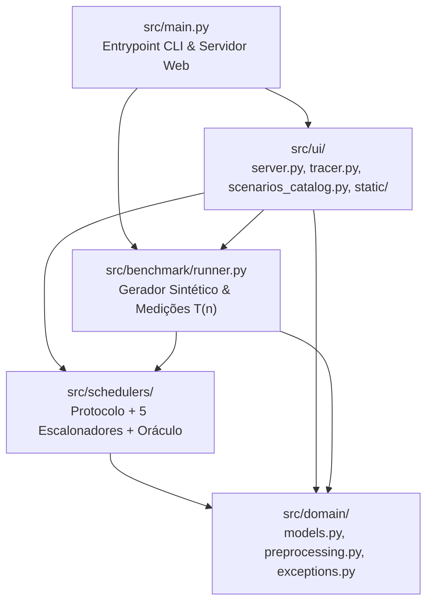
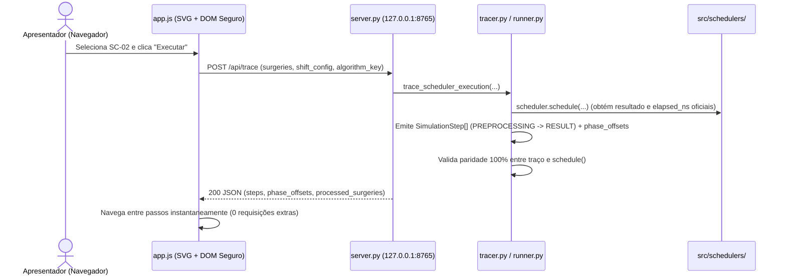

# Guia de Revisão, Arquitetura e Preparação para Apresentação

Este documento serve como **guia completo de estudo e defesa oral** para todos os integrantes do grupo, explicando a arquitetura SOLID, cada módulo e função com referências exatas de arquivo e linha (`#Lxx-Lyy`), o funcionamento interno do rastreador passo a passo e da interface web SVG, o roteiro prático de demonstração em aula e as respostas técnicas para perguntas da banca.

---

## Sumário

- [Módulo 1 — Arquitetura em Camadas e Princípios SOLID](#módulo-1--arquitetura-em-camadas-e-princípios-solid)
- [Módulo 2 — Dissecação Código a Código (Arquivos, Funções e Linhas)](#módulo-2--dissecação-código-a-código-arquivos-funções-e-linhas)
- [Módulo 3 — Mecanismo Interno do Tracer e da Interface Web SVG](#módulo-3--mecanismo-interno-do-tracer-e-da-interface-web-svg)
- [Módulo 4 — Roteiro Prático de Apresentação e Demonstração Ao Vivo](#módulo-4--roteiro-prático-de-apresentação-e-demonstração-ao-vivo)
- [Módulo 5 — FAQ de Defesa (Perguntas Difíceis da Banca)](#módulo-5--faq-de-defesa-perguntas-difíceis-da-banca)

---

## Módulo 1 — Arquitetura em Camadas e Princípios SOLID

O projeto adota uma **arquitetura acíclica em camadas** onde camadas superiores dependem exclusivamente de camadas inferiores, garantindo baixo acoplamento e testabilidade isolada sem servidor gráfico ou dependências externas:

### Aplicação Prática de SOLID e Clean Code
1. **Single Responsibility Principle (SRP)**:
   - `src/domain/models.py` cuida somente dos objetos de valor imutáveis e invariantes estruturais.
   - `src/domain/preprocessing.py` concentra apenas viabilidade ativa, cálculo de $r_i$ e redução ingênua.
   - `src/schedulers/` isola cada algoritmo em sua própria classe pequena e concisa (`ClassicGreedyScheduler`, `ClassicDPScheduler`, `NaiveReductionScheduler`, `AdaptedGreedyScheduler`, `AdaptedDPScheduler`, `BruteForceOracleScheduler`).
   - `src/ui/tracer.py` separa o rastreamento didático passo a passo do caminho quente de produção em `src/schedulers/`.
2. **Open/Closed Principle (OCP)**:
   - Novos algoritmos ou comparadores podem ser plugados no `runner.py` e na interface simplesmente implementando `IntervalSchedulerProtocol`.
3. **Liskov Substitution Principle (LSP)**:
   - Qualquer uma das classes escalonadoras pode ser passada polimorficamente para `run_scaling_benchmark` ou testada via contrato único `.schedule(surgeries, shift_config, is_presorted=...)`.
4. **Interface Segregation & Dependency Inversion Principle (ISP / DIP)**:
   - [`IntervalSchedulerProtocol`](../src/schedulers/protocol.py#L20-L37) define apenas `.name` e `.schedule(...)`. Tanto o módulo de benchmark quanto a camada de apresentação dependem da abstração, e `src/domain/` **nunca** importa `src/schedulers/` (a validação `validate_scheduler_inputs` fica em `src/domain/preprocessing.py` e é reexportada em `src/schedulers/protocol.py`).
5. **Imutabilidade Defensiva**:
   - Todas as entidades de domínio e snapshots de simulação usam `@dataclass(frozen=True)`, e coleções recebidas do chamador são copiadas defensivamente antes de qualquer ordenação.

---

## Módulo 2 — Dissecação Código a Código (Arquivos, Funções e Linhas)

### 2.1. Camada de Domínio (`src/domain/`)

#### [`src/domain/exceptions.py`](../src/domain/exceptions.py#L1-L5)
- [`InvalidSchedulingInputError`](../src/domain/exceptions.py#L4-L5): subclasse de `ValueError` usada em toda a aplicação para sinalizar violações de invariantes de entrada (intervalo inválido, janela $[A, B]$ malformada, `is_presorted=True` fora de ordem ou oráculo acima de $n > 20$).

#### [`src/domain/models.py`](../src/domain/models.py#L1-L186)
- [`is_strict_int`](../src/domain/models.py#L9-L11): rejeita `bool` (`isinstance(True, int)` é verdadeiro em Python!) para impedir que `True`/`False` sejam aceitos como minutos.
- [`SurgeryType`](../src/domain/models.py#L14-L18): enumeração `CLEAN` e `CONTAMINATED`.
- [`ShiftWindow`](../src/domain/models.py#L21-L41): representa a janela $[A, B)$ garantindo $0 \le A < B$ no `__post_init__`.
- [`ShiftConfig`](../src/domain/models.py#L44-L69): encapsula o horizonte de fechamento $H > 0$ e `shift_window` opcional ($B \le H$).
- [`SurgeryRequest`](../src/domain/models.py#L72-L122): valida `surgery_id` não vazio, $0 \le s_i < f_i$, `c_i == 0` para `CLEAN` e `c_i > 0` para `CONTAMINATED`.
- [`ProcessedSurgery`](../src/domain/models.py#L125-L145): associa a solicitação ao instante `effective_release_time` ($r_i \ge f_i$).
- [`SchedulingResult`](../src/domain/models.py#L148-L186): retorna algoritmo, tupla cronológica selecionada, `total_selected`, `discarded_infeasible_count` e `elapsed_ns`.

#### [`src/domain/preprocessing.py`](../src/domain/preprocessing.py#L1-L168)
- [`validate_scheduler_inputs`](../src/domain/preprocessing.py#L13-L38): valida sequência (rejeitando `None`, `str`, `bytes` e elementos inválidos) e devolve uma cópia `list` em $\mathcal{O}(n)$ sem mutar a entrada do chamador.
- [`is_actively_feasible`](../src/domain/preprocessing.py#L41-L63): núcleo da regra médica ativa em $\mathcal{O}(1)$. Retorna `True` se `shift_config is None`; caso contrário exige `finish_time <= closing_horizon` e, se houver `[A, B]`, exige `finish_time <= A or start_time >= B`.
- [`compute_effective_release_time`](../src/domain/preprocessing.py#L66-L88): fórmula fechada em $\mathcal{O}(1)$: calcula `raw_end = finish_time + sterilization_duration` e retorna `window.end` ($B$) se `finish_time <= A < raw_end < B`; caso contrário retorna `raw_end`.
- [`preprocess_validated_surgeries`](../src/domain/preprocessing.py#L91-L111) e [`preprocess_feasible_surgeries`](../src/domain/preprocessing.py#L114-L120): filtram as $n' \le n$ cirurgias viáveis em $\mathcal{O}(n)$ retornando `(feasible, discarded_count)`.
- [`_is_naive_interval_feasible`](../src/domain/preprocessing.py#L123-L136), [`preprocess_naive_validated_surgeries`](../src/domain/preprocessing.py#L139-L159) e [`preprocess_naive_static_reduction`](../src/domain/preprocessing.py#L162-L168): aplicam o erro clássico de tratar $f'_i = f_i + c_i$ como intervalo ativo contra $H$ e $[A, B]$ para evidenciar o contrexemplo `SC-02` e `SC-03`.

---

### 2.2. Camada de Protocolo e Escalonadores (`src/schedulers/`)

#### [`src/schedulers/protocol.py`](../src/schedulers/protocol.py#L1-L236)
Centraliza o contrato e elimina qualquer duplicação entre as variantes Clássica e Adaptada:
- [`IntervalSchedulerProtocol`](../src/schedulers/protocol.py#L20-L37): contrato `@runtime_checkable`.
- [`_order_sequence_by_key`](../src/schedulers/protocol.py#L40-L56), [`order_surgeries_by_key`](../src/schedulers/protocol.py#L59-L66) e [`order_processed_surgeries`](../src/schedulers/protocol.py#L69-L83): se `is_presorted=False`, ordenam via Timsort em $\mathcal{O}(n \log n)$ por `(effective_release_time, finish_time, start_time)`; se `is_presorted=True`, apenas verificam monotonicidade em uma passada $\mathcal{O}(n)$.
- [`select_greedy_processed_surgeries`](../src/schedulers/protocol.py#L86-L96): varredura linear $\mathcal{O}(n)$ que escolhe todo item com `start_time >= last_release` e atualiza `last_release = effective_release_time`.
- [`validate_presorted_start_indices`](../src/schedulers/protocol.py#L106-L135): garante em $\mathcal{O}(n)$ que a permutação opcional `presorted_start_indices` cobre `0..n'-1` em ordem não decrescente de `start_time`.
- [`_are_starts_monotonic`](../src/schedulers/protocol.py#L138-L143), [`_compute_predecessors_two_pointers`](../src/schedulers/protocol.py#L146-L161), [`_compute_predecessors_binary_search`](../src/schedulers/protocol.py#L164-L175) e [`_resolve_predecessors`](../src/schedulers/protocol.py#L178-L189):
  - **Modo Dois Ponteiros ($\mathcal{O}(n)$)**: usado quando `is_presorted=True` com `presorted_start_indices` válido ou inícios já monótonos; o ponteiro `release_ptr` avança monotonicamente no máximo $n'$ vezes no total.
  - **Modo Busca Binária ($\mathcal{O}(n \log n)$)**: calcula `bisect.bisect_right(release_times, start_time, lo=0, hi=idx)` para cada item.
- [`solve_interval_dp`](../src/schedulers/protocol.py#L192-L225): preenche `dp[1..n']` com `max(dp[i-1], 1 + dp[p[i]])` em $\mathcal{O}(n)$ e faz *backtracking* iterativo de `n'` até `0` em $\mathcal{O}(n)$, devolvendo os itens em ordem cronológica.

#### Os 5 Escalonadores + Oráculo Exato
1. [`ClassicGreedyScheduler`](../src/schedulers/classic_greedy.py#L15-L61): ignora $c_i$ e `shift_config`, ordena por `(finish_time, start_time)` e seleciona com `start_time >= last_finish`.
2. [`ClassicDPScheduler`](../src/schedulers/classic_dp.py#L21-L71): encapsula cada solicitação com `effective_release_time=finish_time` e delega a `order_processed_surgeries` + `solve_interval_dp`.
3. [`NaiveReductionScheduler`](../src/schedulers/naive_reduction.py#L17-L49): usa `preprocess_naive_validated_surgeries` ($f'_i = f_i + c_i$) + varredura gulosa.
4. [`AdaptedGreedyScheduler`](../src/schedulers/adapted_greedy.py#L17-L47): executa `preprocess_validated_surgeries` ($\mathcal{O}(n)$), `order_processed_surgeries` ($\mathcal{O}(n \log n)$ ou $\mathcal{O}(n)$) e `select_greedy_processed_surgeries` ($\mathcal{O}(n)$).
5. [`AdaptedDPScheduler`](../src/schedulers/adapted_dp.py#L19-L69): executa `preprocess_validated_surgeries`, bloqueia `presorted_start_indices` caso `discarded_count > 0` (evitando desalinhamento de índices após filtragem) e delega a `solve_interval_dp`.
6. [`BruteForceOracleScheduler`](../src/schedulers/brute_force_oracle.py#L22-L56) e [`_search_exact_optimum`](../src/schedulers/brute_force_oracle.py#L59-L86): trava imediatamente entradas com $n > 20$ (`MAX_ORACLE_INPUT_SIZE` em [`#L19`](../src/schedulers/brute_force_oracle.py#L19)) e aplica *branch-and-bound* com poda `len(current) + (n - idx) <= len(best)` para certificar o ótimo global em instâncias pequenas.

---

### 2.3. Benchmark e Entrypoint (`src/benchmark/`, `src/main.py`)

- [`BenchmarkPoint`](../src/benchmark/runner.py#L20-L33): registro imutável com `median_elapsed_ns`, `mean_elapsed_ns`, `median_elapsed_ms`, `ratio_n_log_n` e `ratio_n`.
- [`generate_synthetic_surgeries`](../src/benchmark/runner.py#L36-L88): cria cargas hospitalares reproduzíveis via `random.Random(seed)`.
- [`_prepare_scheduler_input`](../src/benchmark/runner.py#L91-L119) e [`run_scaling_benchmark`](../src/benchmark/runner.py#L177-L241): isolam geração e pré-ordenação externa da medição interna `result.elapsed_ns` e agregam a mediana sobre `repetitions`.
- [`format_benchmark_table`](../src/benchmark/runner.py#L244-L264): formata tabela alinhada para terminal e UI.
- [`build_arg_parser`](../src/main.py#L15-L75), [`_run_scenario_cli`](../src/main.py#L78-L105), [`_run_benchmark_cli`](../src/main.py#L108-L123) e [`main`](../src/main.py#L126-L164): disponibilizam tanto modos *headless* (`--scenario`, `--benchmark`) quanto a abertura do servidor HTTP local.

---

## Módulo 3 — Mecanismo Interno do Tracer e da Interface Web SVG

Para cumprir `[RNF-02]` (zero interferência na medição `elapsed_ns`), os algoritmos de `src/schedulers/` permanecem intactos. Toda a inspeção didática acontece no módulo desacoplado [`src/ui/`](../src/ui/__init__.py#L1-L55):

### Detalhamento dos Módulos de Interface
1. **Catálogo Compartilhado ([`src/ui/scenarios_catalog.py`](../src/ui/scenarios_catalog.py#L12-L295))**:
   - Fonte única de verdade para os presets `SC-01` a `SC-05b` (`ScenarioPreset`, `get_scenario_presets`, `get_scenario_by_id`), reexportada por [`tests/fixtures/scenarios.py`](../tests/fixtures/scenarios.py#L1-L23).
2. **Tracer Multiestágio e Arena Comparativa ([`src/ui/tracer.py`](../src/ui/tracer.py#L31-L1031))**:
   - [`TracePhase`](../src/ui/tracer.py#L42-L50) e [`SurgeryVisualStatus`](../src/ui/tracer.py#L53-L61): modelam as 6 fases e os 6 estados visuais de cada barra no Gantt.
   - [`_trace_preprocessing_phase`](../src/ui/tracer.py#L221-L345), [`_trace_sorting_phase`](../src/ui/tracer.py#L348-L390), [`_trace_predecessors_phase`](../src/ui/tracer.py#L393-L531), [`_trace_greedy_selection_phase`](../src/ui/tracer.py#L534-L590) e [`_trace_dp_table_and_backtracking`](../src/ui/tracer.py#L593-L691): capturam a evolução de cada variável (`s_i`, `f_i`, `c_i`, `r_i`, `last_release`, `lo`, `mid`, `hi`, `release_ptr`, `p_i`, `include_count`, `exclude_count`, `dp_i`, `current`) em snapshots imutáveis [`SimulationStep`](../src/ui/tracer.py#L64-L82).
   - [`trace_scheduler_execution`](../src/ui/tracer.py#L695-L815): limita o traço interativo a `MAX_TRACE_INPUT_SIZE = 200` e verifica por `AssertionError` que a saída reconstruída pelo tracer é idêntica à saída oficial de `schedule()`.
   - [`_audit_physical_conflicts`](../src/ui/tracer.py#L818-L850) e [`run_comparative_arena`](../src/ui/tracer.py#L884-L915): executam os 5 algoritmos e detectam automaticamente violações reais de $H$, $[A, B]$ ou esterilização $c_i$ nas agendas clássicas.
3. **Servidor HTTP Local e Segurança ([`src/ui/server.py`](../src/ui/server.py#L42-L468))**:
   - Usa `ThreadingHTTPServer` vinculado a `127.0.0.1` por padrão ([`create_http_server`](../src/ui/server.py#L457-L468)).
   - [`parse_shift_config_payload`](../src/ui/server.py#L65-L95) e [`parse_surgeries_payload`](../src/ui/server.py#L98-L138): reconstroem entidades de domínio validando tipos estritos e mapeiam `InvalidSchedulingInputError` para `HTTP 400`.
   - [`SimulationRequestHandler._read_json_body`](../src/ui/server.py#L354-L402) impõe teto `MAX_REQUEST_BODY_BYTES = 262_144` (com drenagem limitada de TCP no Windows antes de `HTTP 413`) e [`_send_static_file`](../src/ui/server.py#L324-L352) bloqueia *path traversal* fora de `src/ui/static/`.
   - Os manipuladores [`_handle_trace_request`](../src/ui/server.py#L150-L182), [`_handle_compare_request`](../src/ui/server.py#L185-L203), [`_handle_generate_request`](../src/ui/server.py#L206-L231) e [`_handle_benchmark_request`](../src/ui/server.py#L234-L303) aplicam limites contra travamentos ($n \le 200$ no tracer, $n \le 5000$ no gerador, $n \le 10000$ e `repetitions <= 20` no benchmark).
4. **Frontend Zero-Deps em 3 Abas ([`src/ui/static/index.html`](../src/ui/static/index.html#L1-L287) e [`src/ui/static/app.js`](../src/ui/static/app.js#L1-L1033))**:
   - **Máscara e Validação `HH:MM`**: [`attachHhmmInputMask`](../src/ui/static/app.js#L45-L57) e [`parseHhmmToMinutes`](../src/ui/static/app.js#L59-L71) inserem `:` automaticamente e impedem inclusão de cirurgias com `startTime >= finishTime`.
   - **Gantt SVG Interativo**: [`buildGanttSvg`](../src/ui/static/app.js#L226-L445) renderiza barras ativas sólidas, extensões hachuradas (`#steril-hatch`) para $[f_i, f_i + c_i]$, banda sombreada $[A, B]$, linha $H$, marcador $r_i$ e linha móvel `last_release`.
   - **Inspetores Sincronizados**: [`renderVariablesWatch`](../src/ui/static/app.js#L463-L478) e [`renderArraysInspector`](../src/ui/static/app.js#L480-L568) destacam em tempo real o índice ativo, o predecessor referenciado e a janela `[lo, mid, hi]` da busca binária; [`buildLineChartSvg`](../src/ui/static/app.js#L726-L816) plota as curvas empíricas na Aba 3. Todo texto do usuário é inserido exclusivamente via `.textContent` (prevenindo XSS).

---

## Módulo 4 — Roteiro Prático de Apresentação e Demonstração Ao Vivo

Sugestão de roteiro de **10 a 12 minutos** para a apresentação em sala:

### Ato 1 — Contexto e Modelo Matemático (2 min)
1. Abrir a aplicação com `python -m src.main` (já inicia carregando **`SC-02`**).
2. Explicar no Gantt inicial a diferença entre **barra sólida** (atuação médica $[s_i, f_i]$) e **extensão hachurada** (esterilização automatizada sem equipe $[f_i, f_i + c_i]$).
3. Apresentar a fórmula de $r_i$ e por que $f'_i = f_i + c_i$ falha quando a esterilização ocorre após $H$ ou dentro de $[A, B]$.

### Ato 2 — Simulação Passo a Passo na Aba 1 (4 min)
1. Com **`SC-02`** e **Guloso Adaptado**, clicar em **Próximo** mostrando:
   - Pré-processamento mantendo `S3` viável ($f_3 = \text{17:45} \le \text{18:00}$) com $r_3 = \text{18:45}$;
   - Ordenação colocando `S2` ($r_2 = \text{15:00}$) antes de `S1` ($r_1 = \text{16:00}$);
   - Varredura gulosa selecionando `S2`, rejeitando `S1` (`13:00 < 15:00`) e selecionando `S3` (`15:00 >= 15:00`).
2. Trocar para **Programação Dinâmica Adaptada** no mesmo **`SC-02`** e usar os **botões de salto por fase**:
   - Mostrar em **Estruturas de Dados** a busca binária definindo `p[1..3]` (`p = [0, 0, 1]`), o preenchimento `DP = [0, 1, 1, 2]` e o *backtracking* saltando de `i=3` (`S3`) para `p[3]=1` (`S2`).
3. Carregar **`SC-04b`** e **`SC-04c`**: mostrar a banda vermelha `[12:00, 13:00]`, destacando o ajuste automático de $r_i = \text{13:00}$ quando absorvido pela pausa (`SC-04b`) versus o bloqueio até `13:15` quando transborda (`SC-04c`).

### Ato 3 — Arena Comparativa dos 5 Algoritmos na Aba 2 (2 min)
1. Voltar para **`SC-02`** e abrir a aba **2. Arena Comparativa**.
2. Mostrar na tabela e nos 5 mini-Gantts:
   - `Classic Greedy` e `Classic DP` com selo **Conflito** (agendam `S1` e `S3` ignorando as 2h de ozônio de `S1`);
   - `Naive Static Reduction` descartando `S3` e marcando apenas `1`;
   - `Adapted Greedy` e `Adapted DP` ambos **Válidos** com `2` cirurgias (`S2, S3`).

### Ato 4 — Complexidade Empírica na Aba 3 e Teste Ao Vivo (3 min)
1. Abrir a aba **3. Benchmark & Complexidade** e clicar em **Executar Benchmark** (`100, 500, 1000, 2500, 5000`).
2. Apontar o gráfico **$T(n)/(n \log_2 n)$** estabilizando em uma faixa constante (prova visual de $\Theta(n \log n)$ para ambas as estratégias adaptadas), e marcar **Modo pré-ordenado $\Theta(n)$** para mostrar $T(n)/n$ linear.
3. No painel lateral esquerdo, demonstrar a entrada ao vivo em `HH:MM` adicionando uma cirurgia de teste (ou mostrando a rejeição de um intervalo inválido) para provar flexibilidade total frente a pedidos da banca.

---

## Módulo 5 — FAQ de Defesa (Perguntas Difíceis da Banca)

**1. Por que vocês não simplesmente somaram $c_i$ ao horário de término $f_i$ antes de chamar o algoritmo clássico?**
> Porque a redução estática $f'_i = f_i + c_i$ trata a esterilização como se fosse atuação médica ativa. Isso gera dois erros provados no `SC-02` e `SC-04b`: (a) descarta injustamente uma última cirurgia que termina às `17:45` ($f_i \le H$), mas cuja máquina esteriliza sozinha até `18:45` ($f'_i > H$); (b) descarta cirurgias antes da troca de plantão cuja esterilização ocorre em paralelo dentro de $[A, B]$. Nosso modelo separa **viabilidade ativa** (regras sobre $[s_i, f_i]$) de **liberação efetiva $r_i$**.

**2. Por que a escolha gulosa pelo menor $r_i$ continua 100% ótima se a pausa $[A, B]$ cria um "salto" não linear em $r_i$?**
> Porque o argumento clássico de troca (*"Greedy Stays Ahead"*) depende apenas de existir uma ordem total de disponibilidade da sala após cada escolha. Como toda cirurgia $j$ já foi previamente filtrada quanto a $[A, B]$ e $H$, e $r_i$ sintetiza o menor instante válido $\ge f_i$ fora de $[A, B)$ em que a sala está estéril, a viabilidade de encadear $j$ após $i$ reduz-se a uma única desigualdade escalar $s_j \ge r_i$. Logo, trocar a $k$-ésima cirurgia de qualquer solução ótima pela escolhida pelo Guloso Adaptado nunca piora $r_{g_k} \le r_{o_k}$.

**3. O que aconteceria com a complexidade se adicionássemos pesos/prioridades por cirurgia ou tempos de limpeza dependentes do par $(i, j)$?**
> Se adicionássemos prioridades (pesos) arbitrárias, o problema passaria a ser o *Weighted Interval Scheduling*, onde o algoritmo guloso **perde a otimalidade** (sobrando apenas a PD em $\mathcal{O}(n \log n)$). Já se os tempos de setup dependessem de pares específicos $(i, j)$ (*Sequence-Dependent Setup Times*), o problema equivaleria a variantes de roteamento/escalonamento em máquina única (**NP-Difícil**), impossibilitando solução exata polinomial. A esterilização dependente apenas da cirurgia anterior $i$ somada à janela fixa $[A, B]$ preserva tanto a otimalidade gulosa quanto $\mathcal{O}(n \log n)$.

**4. Como a PD Adaptada atinge $\mathcal{O}(n)$ no modo pré-ordenado se precisa calcular predecessores $p(i)$?**
> No modo geral, $p(i)$ usa `bisect_right` em $\mathcal{O}(\log n)$ por item ($\mathcal{O}(n \log n)$ total). Porém, quando a entrada já vem pré-ordenada por $r_i$ e também dispomos da ordem de inícios $s_i$ (via `presorted_start_indices` ou inícios monótonos), `solve_interval_dp` utiliza varredura com **dois ponteiros** ([`protocol.py`](../src/schedulers/protocol.py#L146-L161)): o ponteiro `release_ptr` só avança da esquerda para a direita ao longo dos $n'$ itens, realizando no máximo $n'$ incrementos somados para todos os itens ($\mathcal{O}(n)$ amortizado).

**5. Por que `AdaptedDPScheduler` rejeita `presorted_start_indices` quando alguma cirurgia é descartada por $H$ ou $[A, B]$?**
> Porque `presorted_start_indices` indexa a lista de tamanho original $n$, mas após filtrar cirurgias inviáveis restam $n' < n$ itens em `feasible`. Aceitar índices de tamanho $n$ causaria `IndexError` ou desalinhamento silencioso de predecessores; por segurança explícita ([`adapted_dp.py`](../src/schedulers/adapted_dp.py#L42-L52)), essa combinação dispara `InvalidSchedulingInputError`.

**6. Como vocês garantem que a captura dos passos da interface não distorce os tempos de execução do benchmark?**
> Seguindo `[RNF-02]`, `src/schedulers/*.py` não possui nenhum código de log ou *hook* de rastreamento. A interface chama o módulo isolado [`trace_scheduler_execution`](../src/ui/tracer.py#L695-L815) apenas quando o usuário simula passo a passo (limitado a $n \le 200$), enquanto os benchmarks chamam diretamente `.schedule()` medindo apenas `time.perf_counter_ns()`.

**7. Como vocês validam que a implementação realmente acerta 100% dos casos além dos testes manuais?**
> Além dos cenários determinísticos `SC-01`..`SC-05b`, o projeto implementa um **Oráculo Exato por Força Bruta com poda** ([`brute_force_oracle.py`](../src/schedulers/brute_force_oracle.py#L22-L86)) e executa validação cruzada em **180 instâncias aleatórias** (`seed` fixa) verificando que `Adapted Greedy == Adapted DP == Brute-Force Oracle` em 100% dos casos e que nenhuma agenda viola restrições físicas.

**8. Por que construir a interface com servidor HTTP Stdlib + SVG nativo em vez de Streamlit ou Plotly?**
> Para manter **zero dependências de terceiros** (`dependencies = []` em `pyproject.toml`), evitar reexecuções de página inteira a cada clique no modo passo a passo (que geram latência/cintilação em frameworks reativos top-down) e ter controle pixel a pixel em SVG para desenhar hachuras de esterilização dentro da janela $[A, B]$ e após $H$, sincronizadas com os vetores `p[i]` e `DP[i]`.
