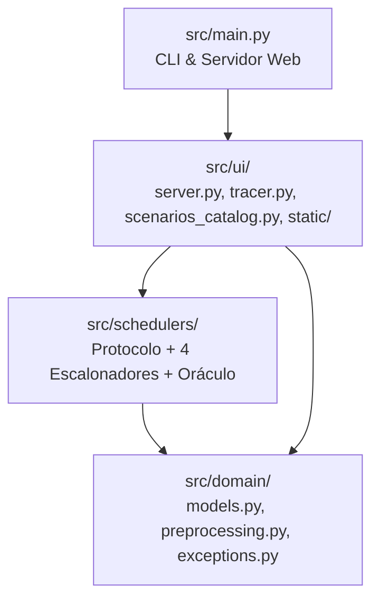

# Guia de Revisão, Arquitetura e Preparação para Apresentação

Este documento é o **guia prático de estudo, validação da interface e defesa oral** para a dupla apresentar o projeto no DataShow, detalhando a arquitetura SOLID, cada método principal com **quem chama, parâmetros, retorno, funcionamento mecânico passo a passo e complexidade**, o mecanismo interno da interface web e o checklist guiado `Ação → Resultado Esperado`.

> Para acompanhar a notação matemática formal e testes de mesa passo a passo, consulte também: [Formulação Matemática e Comparativo Algorítmico](formulacao-matematica-e-comparativo-algoritmos.md).

---

## Sumário

- [Módulo 1 — Arquitetura em Camadas e Fluxo `UI ↔ Tracer ↔ Schedulers`](#módulo-1--arquitetura-em-camadas-e-fluxo-ui--tracer--schedulers)
- [Módulo 2 — Dissecação Profunda dos Métodos Principais](#módulo-2--dissecação-profunda-dos-métodos-principais)
- [Módulo 3 — Mecanismo Interno do Tracer e da Interface Web SVG](#módulo-3--mecanismo-interno-do-tracer-e-da-interface-web-svg)
- [Módulo 4 — Roteiro em Dupla (DataShow) e Checklist de Validação da Interface](#módulo-4--roteiro-em-dupla-datashow-e-checklist-de-validação-da-interface)
- [Módulo 5 — FAQ de Defesa (Perguntas da Professora)](#módulo-5--faq-de-defesa-perguntas-da-professora)

---

## Módulo 1 — Arquitetura em Camadas e Fluxo `UI ↔ Tracer ↔ Schedulers`

O projeto adota uma **arquitetura acíclica em camadas** onde camadas superiores dependem exclusivamente de camadas inferiores, usando apenas a Biblioteca Padrão do Python:

### Como a Interface (`src/ui/`) Interage com os Algoritmos (`src/schedulers/`)
1. **Separação Limpa (Sem Poluir os Algoritmos)**: As classes em `src/schedulers/` (`ClassicGreedyScheduler`, `ClassicDPScheduler`, `AdaptedGreedyScheduler`, `AdaptedDPScheduler`) recebem `(surgeries, shift_config)` e devolvem apenas o resultado final ([`SchedulingResult`](../src/domain/models.py#L149-L186)), sem código de interface ou logs.
2. **Execução Oficial + Gravação dos Passos (`POST /api/trace`)**:
   - Quando a Aba 1 executa um algoritmo, [`_handle_trace_request`](../src/ui/server.py#L123-L140) converte o JSON para objetos de domínio e chama [`trace_scheduler_execution`](../src/ui/tracer.py#L731-L838).
   - O `tracer.py` roda **primeiro** o algoritmo oficial (`final_result = scheduler.schedule(items, shift_config=shift_config)`).
   - Em seguida, executa as funções de rastreamento que emitem uma lista de *snapshots* imutáveis ([`SimulationStep`](../src/ui/tracer.py#L61-L79)) para cada micro-passo (pré-processamento, ordenação, busca binária, tabela DP/varredura gulosa, *backtracking* e resultado), além do card de complexidade ([`_build_complexity_summary`](../src/ui/tracer.py#L629-L728)).
   - Antes de responder ao navegador, o `tracer.py` valida com `AssertionError` que a agenda reconstruída no último passo é **100% idêntica** à de `scheduler.schedule()`.
3. **Comparativo Direto (`POST /api/compare`)**:
   - Na Aba 2, [`run_comparative_arena`](../src/ui/tracer.py#L876-L898) executa `.schedule()` diretamente nos 4 algoritmos e passa cada agenda gerada pelo auditor [`_audit_physical_conflicts`](../src/ui/tracer.py#L841-L873) para detectar violações de $H$, $[A, B)$ ou esterilização.

---

## Módulo 2 — Dissecação Profunda dos Métodos Principais

### 2.1. Modelos de Domínio ([`src/domain/models.py`](../src/domain/models.py#L1-L186))
- [`InvalidSchedulingInputError`](../src/domain/exceptions.py#L4-L5): exceção `ValueError` para entradas inválidas.
- [`is_strict_int`](../src/domain/models.py#L9-L11): garante inteiro real rejeitando `bool` (`isinstance(True, int)` é `True` em Python).
- [`SurgeryType`](../src/domain/models.py#L14-L18), [`ShiftWindow`](../src/domain/models.py#L22-L41), [`ShiftConfig`](../src/domain/models.py#L45-L69), [`SurgeryRequest`](../src/domain/models.py#L73-L122), [`ProcessedSurgery`](../src/domain/models.py#L126-L145) e [`SchedulingResult`](../src/domain/models.py#L149-L186): todos `@dataclass(frozen=True)` imutáveis validados no `__post_init__`.

---

### 2.2. Pré-processamento e Adaptação ([`src/domain/preprocessing.py`](../src/domain/preprocessing.py#L1-L120))

#### Ficha 1 — [`validate_scheduler_inputs`](../src/domain/preprocessing.py#L13-L38)
- **Onde é chamado**: No início de `.schedule()` em todos os 4 escalonadores + Oráculo, e no início de `trace_scheduler_execution` / `run_comparative_arena`.
- **Parâmetros**: `surgeries: Sequence[SurgeryRequest]` e `shift_config: ShiftConfig | None`.
- **Retorno**: `list[SurgeryRequest]` (cópia defensiva nova).
- **Como funciona por dentro**:
  1. Rejeita `None`, `str`, `bytes` ou objetos que não implementem `Sequence`, e verifica se `shift_config` é `None` ou `ShiftConfig`.
  2. Percorre cada elemento de `surgeries`, valida `isinstance(item, SurgeryRequest)` e copia para uma nova lista `copied`. Isso garante que ordenar ou manipular `copied` nunca altere a lista original do chamador.
- **Complexidade**: **$\mathcal{O}(n)$** tempo e **$\mathcal{O}(n)$** espaço auxiliar.

#### Ficha 2 — [`is_actively_feasible`](../src/domain/preprocessing.py#L41-L63)
- **Onde é chamado**: Dentro de `preprocess_validated_surgeries` (usado por `AdaptedGreedy`, `AdaptedDP` e `BruteForceOracle`) e em `_trace_preprocessing_phase` / `_audit_physical_conflicts`.
- **Parâmetros**: `surgery: SurgeryRequest`, `shift_config: ShiftConfig | None`.
- **Retorno**: `bool` (`True` se a equipe médica pode operar no turno; `False` caso contrário).
- **Como funciona por dentro**:
  1. Se `shift_config is None`, retorna `True` imediatamente (sem restrição de turno).
  2. Verifica o horizonte de fechamento: `if surgery.finish_time > shift_config.closing_horizon: return False`. (Nota: checa apenas `finish_time`, **nunca** `finish_time + sterilization_duration`, permitindo esterilização passiva após $H$).
  3. Se existir janela `[A, B]` (`window = shift_config.shift_window`), retorna `True` somente se `surgery.finish_time <= window.start` (acaba antes ou em $A$) **ou** `surgery.start_time >= window.end` (começa em ou depois de $B$).
  - *Exemplo (`CASE-03`)*: `S2` (`11:30–12:30`, `690–750`) contra `[720, 780]` falha em ambos (`750 <= 720` é falso e `690 >= 780` é falso) $\implies$ `False`. Já `S1` (`10:00–11:30`, `600–690`) tem `690 <= 720` $\implies$ `True`.
- **Complexidade**: **$\mathcal{O}(1)$** tempo e **$\mathcal{O}(1)$** espaço.

#### Ficha 3 — [`compute_effective_release_time`](../src/domain/preprocessing.py#L66-L88)
- **Onde é chamado**: Dentro de `preprocess_validated_surgeries`, `_trace_preprocessing_phase` e `_audit_physical_conflicts`.
- **Parâmetros**: `surgery: SurgeryRequest`, `shift_config: ShiftConfig | None`.
- **Retorno**: `int` representando $r_i$ em minutos.
- **Como funciona por dentro**:
  1. Calcula `raw_end = surgery.finish_time + surgery.sterilization_duration` ($e_i = f_i + c_i$).
  2. Se existir janela `[A, B]`, testa a condição exata de absorção: `surgery.finish_time <= window.start and window.start < raw_end < window.end`. Se verdadeira, retorna `window.end` ($B$).
  3. Em todos os demais casos ($e_i \le A$, $e_i \ge B$, cirurgia pós-pausa ou sem janela), retorna `raw_end`.
  - *Exemplo (`CASE-03`)*: `S1` termina às `690` (`11:30 <= 720`) com `c=60`, dando `raw_end = 750` (`12:30`). Como `720 < 750 < 780`, retorna `780` (`13:00`).
- **Complexidade**: **$\mathcal{O}(1)$** tempo e **$\mathcal{O}(1)$** espaço.

#### Ficha 4 — [`preprocess_validated_surgeries`](../src/domain/preprocessing.py#L91-L111) e [`preprocess_feasible_surgeries`](../src/domain/preprocessing.py#L114-L120)
- **Onde é chamado**: `preprocess_validated_surgeries` é chamada por `AdaptedGreedyScheduler`, `AdaptedDPScheduler` e `BruteForceOracleScheduler` (após já terem validado a entrada); `preprocess_feasible_surgeries` é a porta pública para testes e uso externo.
- **Parâmetros**: `items: Sequence[SurgeryRequest]`, `shift_config: ShiftConfig | None = None`.
- **Retorno**: Tupla `(feasible, discarded_count)` onde `feasible` é `list[ProcessedSurgery]` (cada cirurgia viável encapsulada com seu `effective_release_time`) e `discarded_count` é `int`.
- **Complexidade**: **$\mathcal{O}(n)$** tempo e **$\mathcal{O}(n)$** espaço.

---

### 2.3. Contrato e Núcleo Compartilhado ([`src/schedulers/protocol.py`](../src/schedulers/protocol.py#L1-L130))

#### Ficha 5 — [`IntervalSchedulerProtocol`](../src/schedulers/protocol.py#L19-L33)
- Define a interface comum (`name` e `schedule(surgeries, shift_config=None) -> SchedulingResult`). Permite tratar os 4 algoritmos de forma polimórfica em `tracer.py` e nos testes.

#### Ficha 6 — [`_order_sequence_by_key`](../src/schedulers/protocol.py#L36-L41), [`order_surgeries_by_key`](../src/schedulers/protocol.py#L44-L49) e [`order_processed_surgeries`](../src/schedulers/protocol.py#L52-L63)
- **Onde é chamado**: `order_surgeries_by_key` é chamada por `ClassicGreedyScheduler`; `order_processed_surgeries` é chamada por `ClassicDPScheduler`, `AdaptedGreedyScheduler`, `AdaptedDPScheduler` e `BruteForceOracleScheduler`.
- **Como funciona por dentro**: Usa `sorted(items, key=...)` (Timsort do Python).
  - No `ClassicGreedy`, ordena por `(finish_time, start_time)`.
  - Nos demais (`order_processed_surgeries`), ordena por `(effective_release_time, request.finish_time, request.start_time)`. Note que no `ClassicDPScheduler`, `effective_release_time` foi preenchido com `finish_time`, logo a chave equivale a ordenar por `(f_i, s_i)`.
- **Complexidade**: **$\mathcal{O}(n \log n)$** tempo e **$\mathcal{O}(n)$** espaço.

#### Ficha 7 — [`select_greedy_processed_surgeries`](../src/schedulers/protocol.py#L66-L76)
- **Onde é chamado**: Por `AdaptedGreedyScheduler.schedule`.
- **Parâmetros**: `ordered: Sequence[ProcessedSurgery]` (já ordenado por $r_i$).
- **Retorno**: `tuple[ProcessedSurgery, ...]`.
- **Como funciona por dentro**:
  1. Inicializa `selected = []` e `last_release = -1` (pois todos os `start_time >= 0`).
  2. Para cada `item` em `ordered`: se `item.request.start_time >= last_release`, adiciona `item` em `selected` e atualiza `last_release = item.effective_release_time`.
  - *Exemplo (`CASE-02`)*: `ordered = [S2(r=900), S1(r=960), S3(r=1125)]`. `S2` (`810 >= -1`) entra e `last_release = 900`; `S1` (`780 < 900`) é ignorada; `S3` (`900 >= 900`) entra e `last_release = 1125`. Retorna `(S2, S3)`.
- **Complexidade**: **$\mathcal{O}(n)$** tempo e **$\mathcal{O}(n)$** espaço.

#### Ficha 8 — [`compute_predecessors_binary_search`](../src/schedulers/protocol.py#L79-L90)
- **Onde é chamado**: Por `solve_interval_dp` (usado por `ClassicDPScheduler` e `AdaptedDPScheduler`).
- **Parâmetros**: `ordered: Sequence[ProcessedSurgery]` de tamanho $n'$.
- **Retorno**: `list[int]` de tamanho $n' + 1$ com indexação **1-based** (`predecessors[0] == 0` e `predecessors[i]` para $i = 1 \dots n'$).
- **Como funciona por dentro**:
  1. Extrai `release_times = [item.effective_release_time for item in ordered]` (vetor já ordenado crescentemente, índice 0-based `0..n'-1`).
  2. Cria `predecessors = [0] * (n + 1)`.
  3. Para cada `idx` de `0` até `n - 1` (que corresponde ao item `idx + 1` na tabela DP 1-based), executa:
     `bisect.bisect_right(release_times, ordered[idx].request.start_time, lo=0, hi=idx)`.
  - **Por que `bisect_right` funciona direto como índice 1-based?**
    `bisect_right` devolve o **primeiro índice** `k` em `[0, idx]` onde `release_times[k] > start_time`. Ou seja: exatamente `k` elementos anteriores (`release_times[0 .. k-1]`) têm `r_j <= start_time`! Como o índice 0-based do último elemento compatível é `k - 1`, na numeração 1-based da tabela DP ele é exatamente `k` (ou `0` se `k == 0`).
  - *Exemplo (`CASE-02`)*: `release_times = [900, 960, 1125]`. Para `idx=2` (`S3`, `start_time=900`), `bisect_right([900, 960, 1125], 900, lo=0, hi=2)` retorna `1` (porque `900 <= 900` e `960 > 900`). Assim `predecessors[3] = 1` (`S2`).
- **Complexidade**: $n'$ chamadas de busca binária $\implies$ **$\mathcal{O}(n \log n)$** tempo e **$\mathcal{O}(n)$** espaço.

#### Ficha 9 — [`solve_interval_dp`](../src/schedulers/protocol.py#L93-L119)
- **Onde é chamado**: Por `ClassicDPScheduler.schedule` e `AdaptedDPScheduler.schedule`.
- **Parâmetros**: `ordered: Sequence[ProcessedSurgery]`.
- **Retorno**: `tuple[ProcessedSurgery, ...]` (agenda ótima em ordem cronológica).
- **Como funciona por dentro**:
  1. Se `n == 0`, retorna `()`.
  2. Calcula `predecessors = compute_predecessors_binary_search(ordered)`.
  3. **Preenchimento da Tabela (`dp[0..n]`)**: cria `dp = [0] * (n + 1)`. Para `i` de `1` a `n`, calcula `include_count = 1 + dp[predecessors[i]]` e `exclude_count = dp[i - 1]`, gravando o maior em `dp[i]`.
  4. **Reconstrução (*Backtracking* Iterativo)**: começa em `current = n`. Enquanto `current > 0`:
     - Se `1 + dp[predecessors[current]] > dp[current - 1]`, significa que incluir `ordered[current - 1]` foi estritamente melhor: salva `current - 1` em `selected_indices` e salta `current = predecessors[current]`.
     - Caso contrário, recua `current -= 1`.
  5. Como o *backtracking* coleta índices do fim para o início, chama `selected_indices.reverse()` e devolve `tuple(ordered[idx] for idx in selected_indices)`.
- **Complexidade**: Busca de predecessores **$\mathcal{O}(n \log n)$** + preenchimento **$\mathcal{O}(n)$** + backtracking **$\mathcal{O}(n)$** = **$\mathcal{O}(n \log n)$** tempo e **$\mathcal{O}(n)$** espaço.

---

### 2.4. Os 4 Escalonadores Principais + Oráculo Exato

1. **[`ClassicGreedyScheduler`](../src/schedulers/classic_greedy.py#L15-L58)**:
   - Valida a lista (`validate_scheduler_inputs`), ordena por `(finish_time, start_time)` (`order_surgeries_by_key`), faz varredura linear testando `surgery.start_time >= last_finish` e embrulha cada escolhida com `effective_release_time=surgery.finish_time`. Ignora $c_i$, $H$ e $[A, B]$ (`discarded_infeasible_count=0`). **$\mathcal{O}(n \log n)$**.
2. **[`ClassicDPScheduler`](../src/schedulers/classic_dp.py#L19-L51)**:
   - Valida a lista, cria `ProcessedSurgery(request=item, effective_release_time=item.finish_time)` para todas as cirurgias, ordena (`order_processed_surgeries`) e delega a `solve_interval_dp`. Ignora $c_i$, $H$ e $[A, B]$. **$\mathcal{O}(n \log n)$**.
3. **[`AdaptedGreedyScheduler`](../src/schedulers/adapted_greedy.py#L17-L45)**:
   - Valida a lista, filtra e calcula $r_i$ (`preprocess_validated_surgeries`), ordena por `(r_i, f_i, s_i)` (`order_processed_surgeries`) e delega a `select_greedy_processed_surgeries`. **$\mathcal{O}(n \log n)$**.
4. **[`AdaptedDPScheduler`](../src/schedulers/adapted_dp.py#L17-L45)**:
   - Valida a lista, filtra e calcula $r_i$ (`preprocess_validated_surgeries`), ordena por `(r_i, f_i, s_i)` (`order_processed_surgeries`) e delega a `solve_interval_dp`. **$\mathcal{O}(n \log n)$**.
5. **[`BruteForceOracleScheduler`](../src/schedulers/brute_force_oracle.py#L22-L54) e [`_search_exact_optimum`](../src/schedulers/brute_force_oracle.py#L57-L84)**:
   - **Onde é usado**: Exclusivamente nos testes (`tests/test_adapted_schedulers.py` e `tests/test_oracle_and_comparison.py`) para provar que `AdaptedGreedy` e `AdaptedDP` acertam 100% do ótimo global.
   - **Funcionamento**: Bloqueia qualquer entrada com `len(items) > 20` (`MAX_ORACLE_INPUT_SIZE` em [`#L19`](../src/schedulers/brute_force_oracle.py#L19)), roda o mesmo `preprocess_validated_surgeries` + `order_processed_surgeries` e chama `_search_exact_optimum`.
   - **Árvore de busca com poda (*Branch-and-Bound*)**: A função recursiva `_dfs(idx, last_release)` mantém `current_indices` e `best_indices`. Em cada nível `idx`, testa primeiro uma poda de limite superior: `if len(current_indices) + (n - idx) <= len(best_indices): return` (se nem pegando todas as cirurgias restantes for possível bater o recorde atual, abandona o ramo). Caso contrário, explora o ramo **incluir `idx`** (se `candidate.request.start_time >= last_release`, atualizando `last_release = candidate.effective_release_time`) e o ramo **excluir `idx`**. **$\mathcal{O}(2^n)$** no pior caso.

---

## Módulo 3 — Mecanismo Interno do Tracer e da Interface Web SVG

Toda a visualização roda isoladamente em [`src/ui/`](../src/ui/__init__.py#L1-L53) para que `src/schedulers/` permaneça puro:

1. **Catálogo Didático ([`src/ui/scenarios_catalog.py`](../src/ui/scenarios_catalog.py#L13-L229))**: Define os 4 casos padrão `CASE-01` a `CASE-04` (`ScenarioPreset`, `get_scenario_presets`, `get_scenario_by_id`), reutilizados por [`tests/fixtures/scenarios.py`](../tests/fixtures/scenarios.py#L1-L19).
2. **Tracer e Comparador ([`src/ui/tracer.py`](../src/ui/tracer.py#L28-L1015))**:
   - [`TracePhase`](../src/ui/tracer.py#L38-L46) e [`SurgeryVisualStatus`](../src/ui/tracer.py#L49-L57): modelam as 6 fases e os 6 estados visuais do Gantt.
   - [`_build_step_emitter`](../src/ui/tracer.py#L136-L185): cria a função `emit(...)` que grava cada `SimulationStep` e anota `phase_offsets[phase]` no primeiro passo de cada fase (gerando os botões de salto rápido).
   - [`_trace_preprocessing_phase`](../src/ui/tracer.py#L188-L294), [`_trace_sorting_phase`](../src/ui/tracer.py#L297-L352), [`_trace_predecessors_phase`](../src/ui/tracer.py#L355-L449), [`_trace_greedy_selection_phase`](../src/ui/tracer.py#L452-L522) e [`_trace_dp_table_and_backtracking`](../src/ui/tracer.py#L525-L626): capturam variáveis já formatadas em `HH:MM (min)` e o marcador numérico `last_release_minutes`.
   - [`_build_complexity_summary`](../src/ui/tracer.py#L629-L728): consolida a regra matemática do algoritmo selecionado e a contagem real de operações executadas por fase (ex.: comparações do Timsort e iterações da busca binária).
   - [`trace_scheduler_execution`](../src/ui/tracer.py#L731-L838): valida entrada ($n \le 200$), roda `.schedule()` oficial, grava os passos e verifica paridade exata.
   - [`_audit_physical_conflicts`](../src/ui/tracer.py#L841-L873) e [`run_comparative_arena`](../src/ui/tracer.py#L876-L898): executam os 4 algoritmos e detectam conflitos físicos nas agendas clássicas.
3. **Servidor HTTP Local ([`src/ui/server.py`](../src/ui/server.py#L27-L317))**:
   - Sobe `ThreadingHTTPServer` em `127.0.0.1:8765` ([`create_http_server`](../src/ui/server.py#L306-L317)), expondo `GET /api/scenarios`, `POST /api/trace` ([`_handle_trace_request`](../src/ui/server.py#L123-L140)) e `POST /api/compare` ([`_handle_compare_request`](../src/ui/server.py#L143-L154)).
4. **Frontend Enxuto em 2 Abas ([`src/ui/static/index.html`](../src/ui/static/index.html#L1-L249) e [`src/ui/static/app.js`](../src/ui/static/app.js#L1-L962))**:
   - **Cenário Customizado e Turno em Tempo Real**: além dos 4 casos padrão, [`loadPresetById`](../src/ui/static/app.js#L204-L225) oferece a 5ª opção `5. Cenário Customizado (Em Branco)` (`CUSTOM`), e editar $H$ ou $[A, B]$ (ou clicar em `Aplicar Turno`) atualiza o Gantt imediatamente.
   - [`attachHhmmInputMask`](../src/ui/static/app.js#L37-L49) e [`parseHhmmToMinutes`](../src/ui/static/app.js#L51-L63): máscara e validação `HH:MM`.
   - [`renderComplexitySummary`](../src/ui/static/app.js#L463-L489): preenche o card de fórmulas e complexidade por fase.
   - [`computeGanttDomain`](../src/ui/static/app.js#L227-L251) e [`buildGanttSvg`](../src/ui/static/app.js#L253-L461): desenham barras ativas, hachuras de esterilização, $[A, B]$, $H$ e `last_release_minutes`.
   - [`renderVariablesWatch`](../src/ui/static/app.js#L507-L522) e [`renderArraysInspector`](../src/ui/static/app.js#L524-L612): exibem as variáveis locais do passo atual em `HH:MM (min)` e a tabela de vetores (`Ordered[i]`, `r_i`, `p[i]`, `DP[i]`) destacando em **amarelo** o índice ativo `i`, em **lilás** a janela `[lo, hi]` da busca binária e em **azul** o índice referenciado (`mid` ou `p[i]`).
   - [`runComparisonArena`](../src/ui/static/app.js#L706-L782): exibe os 4 algoritmos lado a lado sem scroll interno na tabela e alinha os 4 mini-Gantts na mesma escala horizontal.

---

## Módulo 4 — Roteiro em Dupla (DataShow) e Checklist de Validação da Interface

### Sugestão de Divisão da Dupla (8–10 minutos)
- **Integrante A (Problema, Restrições e Guloso Adaptado)**: Apresenta o problema clássico vs. hospitalar (`CASE-01` e `CASE-02`), explica $H$, $[A, B]$ e $r_i$ usando o card **Resumo Matemático** e conduz a simulação do **Guloso Adaptado** (`CASE-02` e `CASE-03`).
- **Integrante B (PD Adaptada, Comparativo e Complexidade)**: Conduz a **Programação Dinâmica Adaptada** (`CASE-04`, mostrando busca binária `p[i]`, tabela `DP[i]` e *backtracking*), abre a **Aba 2 (Comparativo dos 4 Algoritmos)** provando onde os clássicos falham e fecha explicando a complexidade $\mathcal{O}(n \log n)$ + teste customizado ao vivo.
- **Dica de DataShow**: Ajustem o zoom do navegador para `110%`–`125%` antes de começar. Enquanto um fala, o outro avança os passos no mouse.

### Checklist Guiado de Validação da Interface (`Ação → Resultado Esperado`)

Execute este roteiro na ordem abaixo antes da apresentação (`python -m src.main`) para validar tudo e treinar a fala:

| Etapa | Ação na Interface | Resultado Esperado para Validar na Tela | O que Explicar para a Professora |
| :---: | :--- | :--- | :--- |
| **1** | Iniciar `python -m src.main` | Abre direto em **`CASE-02`**, **Aba 1**, algoritmo **Guloso Adaptado**; Gantt mostra `S1` (`13:00–14:00` + hachura até `16:00`), `S2` (`13:30–15:00`), `S3` (`15:00–17:45` + hachura até `18:45`) e linha `H=18:00`. | Mostrar visualmente a diferença entre **barra sólida** (atuação médica) e **barra hachurada** (esterilização automatizada sem equipe). |
| **2** | Selecionar **`1. Baseline Clássico`** (`CASE-01`) | `4` cirurgias limpas (`S1..S4`), `H=18:00`, sem janela `[A, B]`. Ao avançar até o fim, seleciona **`{S1, S3, S4}` (`3 cirurgias`)**. Na Aba 2, todos os 4 algoritmos dão `3` e selo **Válido**. | Mostrar que, quando não há contaminação nem troca de plantão, as soluções adaptadas se comportam exatamente como as clássicas. |
| **3** | Voltar a **`2. Impacto da Esterilização`** (`CASE-02`) com **Guloso Adaptado** e avançar passo a passo | **Pré-processamento**: `S3` é aceita (`f_3 = 17:45 <= 18:00`) mesmo com `r_3 = 18:45`. **Ordenação**: `Ordered = [S2, S1, S3]`. **Varredura**: seleciona `S2` (linha verde em `15:00`), rejeita `S1` (`13:00 < 15:00`), seleciona `S3` (`15:00 >= 15:00`). Resultado: **`{S2, S3}`**. | Explicar por que ordenar por $r_i$ escolhe `S2` antes de `S1` e por que a esterilização final após $H$ continua válida. |
| **4** | Selecionar **`3. Janela de Troca de Plantão [A, B]`** (`CASE-03`) com **Guloso Adaptado** | Faixa vermelha **`Plantão [12:00, 13:00]`** no Gantt. No pré-processamento: `S2` e `S3` ficam cinza (`descartadas`); `S1` (`10:00–11:30 + 60m`) mostra `e_1 = 12:30` e **`r_1 = 13:00 (780 min)`**. Resultado final: **`{S1, S4, S5}` (`3` selecionadas, `2` descartadas)**. | Explicar a regra de **salto para $B$**: `S1` termina a esterilização dentro da pausa, então a próxima equipe só entra às `13:00` (`S4`). |
| **5** | Selecionar **`4. Turno Hospitalar Completo`** (`CASE-04`) e trocar algoritmo para **PD Adaptada** | Card **Resumo Matemático** exibe fórmulas da PD e contagem real das 5 fases. Saltar para **Predecessores `p[i]`**: células roxas `[lo, hi]` e azul `mid` preenchem `p = [0, 0, 0, 1, 3, 3, 4]`. Em **Seleção / DP**: preenche `DP = [0, 1, 1, 2, 3, 3, 4]`. Em **Backtracking**: salta `6 -> 4 -> 3 -> 1 -> 0` selecionando **`{S2, S3, S6, S7}`**. | Mostrar `Ordered[i]`, `r_i`, `p[i]` e `DP[i]` atualizando ao vivo e apontar a recorrência `DP[i] = max(DP[i-1], 1 + DP[p[i]])`. |
| **6** | Abrir **Aba 2 (`2. Comparativo dos 4 Algoritmos`)** em **`CASE-02`** e **`CASE-04`** | Tabela mostra os 4 algoritmos com complexidade `O(n log n)`. Clássicos aparecem com selo vermelho **Conflito** (explicando exatamente o horário violado); Adaptados aparecem **Válido**. Os 4 mini-Gantts ficam alinhados verticalmente na mesma escala de tempo. | Provar o ganho da adaptação lado a lado na mesma instância. |
| **7** | Teste ao vivo na barra lateral: digitar cirurgia `TEST` (`16:00`–`15:00`) e tentar adicionar; depois corrigir para `16:00`–`17:00` (`CLEAN`) e clicar **`+ Adicionar`** | Primeiro tentativa exibe banner vermelho de erro (`início deve ser estritamente menor que o término`). Ao corrigir para `16:00–17:00`, recalcula automaticamente a simulação/comparativo. | Demonstrar validação defensiva e flexibilidade para testar na hora qualquer exemplo que a professora pedir. |

---

## Módulo 5 — FAQ de Defesa (Perguntas da Professora)

**1. Por que vocês não simplesmente somaram $c_i$ em $f_i$ ($f'_i = f_i + c_i$) e chamaram o algoritmo clássico?**
> Porque somar $c_i$ trata a esterilização como se fosse atuação médica ativa. Isso falha em dois cenários reais mostrados na tela: no **`CASE-02`**, descartaria `S3` (`15:00–17:45 + 60m`) só porque a máquina termina às `18:45` após $H = \text{18:00}$; no **`CASE-03`**, descartaria uma cirurgia pré-pausa cuja esterilização termina durante a troca de plantão `[12:00, 13:00]`.

**2. Por que o Guloso Adaptado pelo menor $r_i$ continua 100% ótimo mesmo com o "salto" da janela $[A, B]$?**
> Porque após filtrar as cirurgias ativamente inviáveis contra $H$ e $[A, B)$, encadear uma cirurgia $j$ após $i$ reduz-se a $s_j \ge r_i$. Como $r_i$ define uma ordem total única de liberação da sala, o argumento de troca (*"Greedy Stays Ahead"*) continua válido: trocar a $k$-ésima cirurgia de qualquer solução ótima pela escolhida pelo Guloso sempre mantém $r_{g_k} \le r_{o_k}$.

**3. Por que os dois algoritmos adaptados têm exatamente a mesma complexidade $\mathcal{O}(n \log n)$?**
> No **Guloso Adaptado**, o pré-processamento é $\mathcal{O}(n)$, a ordenação por $r_i$ é $\mathcal{O}(n \log n)$ e a varredura linear é $\mathcal{O}(n)$. Na **PD Adaptada**, o pré-processamento é $\mathcal{O}(n)$, a ordenação por $r_i$ é $\mathcal{O}(n \log n)$, o cálculo de $p(i)$ com `bisect_right` é $\mathcal{O}(n \log n)$ e o preenchimento de `DP[i]` + *backtracking* são $\mathcal{O}(n)$. Ambos ficam limitados a $\mathcal{O}(n \log n)$ no tempo e $\mathcal{O}(n)$ no espaço.

**4. O que aconteceria se colocássemos pesos (prioridades) diferentes por cirurgia?**
> Com prioridades arbitrárias (*Weighted Interval Scheduling*), a estratégia gulosa **perde a otimalidade** (existem contraexemplos simples em que escolher o menor $r_i$ perde para um único intervalo posterior de peso maior), enquanto a Programação Dinâmica continuaria ótima em $\mathcal{O}(n \log n)$ trocando `1 + DP[p(i)]` por `w_i + DP[p(i)]`.

**5. Como vocês comprovaram que não há nenhum caso de borda quebrando a equivalência `Guloso Adaptado == PD Adaptada`?**
> Além dos testes unitários e dos 4 casos determinísticos, rodamos validação cruzada automática em **180 instâncias aleatórias** (`tests/test_oracle_and_comparison.py`) comparando `AdaptedGreedyScheduler` e `AdaptedDPScheduler` contra o **Oráculo Exato por Força Bruta** ([`brute_force_oracle.py`](../src/schedulers/brute_force_oracle.py#L22-L84)), com 100% de igualdade de cardinalidade e zero conflitos físicos.
