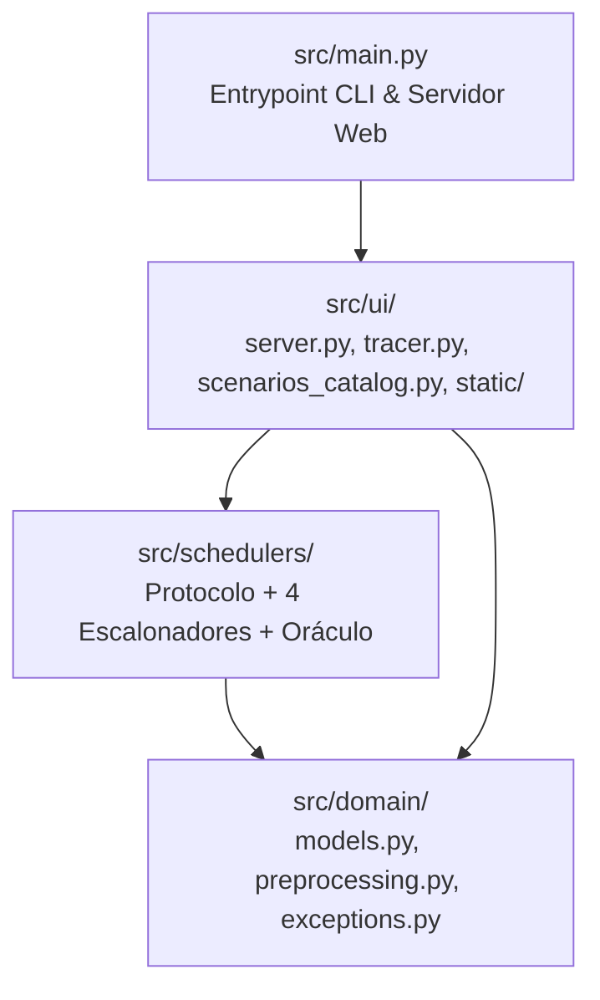
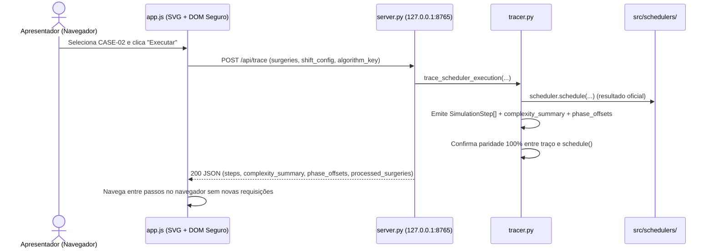

# Guia de Revisão, Arquitetura e Preparação para Apresentação

Este documento é o **guia enxuto de estudo e defesa oral** para a dupla apresentar o projeto com segurança, explicando a arquitetura SOLID, os arquivos essenciais com referências exatas (`#Lxx-Lyy`), o funcionamento da interface web em 2 abas, o roteiro prático ao vivo e respostas diretas para perguntas da banca.

---

## Sumário

- [Módulo 1 — Arquitetura em Camadas e Princípios SOLID](#módulo-1--arquitetura-em-camadas-e-princípios-solid)
- [Módulo 2 — Dissecação Código a Código (Arquivos, Funções e Linhas)](#módulo-2--dissecação-código-a-código-arquivos-funções-e-linhas)
- [Módulo 3 — Mecanismo Interno do Tracer e da Interface Web SVG](#módulo-3--mecanismo-interno-do-tracer-e-da-interface-web-svg)
- [Módulo 4 — Roteiro Prático de Apresentação e Demonstração Ao Vivo](#módulo-4--roteiro-prático-de-apresentação-e-demonstração-ao-vivo)
- [Módulo 5 — FAQ de Defesa (Perguntas da Banca)](#módulo-5--faq-de-defesa-perguntas-da-banca)

---

## Módulo 1 — Arquitetura em Camadas e Princípios SOLID

O projeto adota uma **arquitetura acíclica em camadas** onde camadas superiores dependem exclusivamente de camadas inferiores, sem dependências externas de terceiros:

### Aplicação Prática de SOLID e Clean Code
1. **Single Responsibility Principle (SRP)**:
   - `src/domain/models.py` cuida somente dos objetos de valor imutáveis e invariantes estruturais.
   - `src/domain/preprocessing.py` concentra apenas viabilidade ativa e cálculo da liberação efetiva $r_i$.
   - `src/schedulers/` isola cada algoritmo em sua própria classe pequena e direta (`ClassicGreedyScheduler`, `ClassicDPScheduler`, `AdaptedGreedyScheduler`, `AdaptedDPScheduler`, `BruteForceOracleScheduler`).
   - `src/ui/tracer.py` mantém o rastreamento didático separado dos escalonadores de produção.
2. **Open/Closed e Liskov Substitution (OCP / LSP)**:
   - Todos os escalonadores aderem ao mesmo contrato `.schedule(surgeries, shift_config)`, permitindo execução polimórfica no comparador e nos testes.
3. **Dependency Inversion (DIP)**:
   - [`IntervalSchedulerProtocol`](../src/schedulers/protocol.py#L19-L33) define apenas `.name` e `.schedule(...)`. A camada de domínio (`src/domain/`) **nunca** importa `src/schedulers/`.
4. **Imutabilidade Defensiva**:
   - Todas as entidades e snapshots usam `@dataclass(frozen=True)`, e coleções recebidas do chamador são copiadas defensivamente antes de ordenar.

---

## Módulo 2 — Dissecação Código a Código (Arquivos, Funções e Linhas)

### 2.1. Camada de Domínio (`src/domain/`)

#### [`src/domain/exceptions.py`](../src/domain/exceptions.py#L1-L5)
- [`InvalidSchedulingInputError`](../src/domain/exceptions.py#L4-L5): subclasse de `ValueError` lançada quando alguma invariante de entrada é violada (intervalo invertido, janela $[A, B]$ inválida ou oráculo com $n > 20$).

#### [`src/domain/models.py`](../src/domain/models.py#L1-L186)
- [`is_strict_int`](../src/domain/models.py#L9-L11): rejeita `bool` para impedir que `True`/`False` sejam tratados como minutos inteiros.
- [`SurgeryType`](../src/domain/models.py#L14-L18): enumeração `CLEAN` e `CONTAMINATED`.
- [`ShiftWindow`](../src/domain/models.py#L22-L41): representa a troca de plantão $[A, B)$ garantindo $0 \le A < B$.
- [`ShiftConfig`](../src/domain/models.py#L45-L69): encapsula o horizonte $H > 0$ e `shift_window` opcional ($B \le H$).
- [`SurgeryRequest`](../src/domain/models.py#L73-L122): valida `surgery_id` não vazio, $0 \le s_i < f_i$, $c_i = 0$ para `CLEAN` e $c_i > 0$ para `CONTAMINATED`.
- [`ProcessedSurgery`](../src/domain/models.py#L126-L145): associa a cirurgia ao seu instante `effective_release_time` ($r_i \ge f_i$).
- [`SchedulingResult`](../src/domain/models.py#L149-L186): retorna nome do algoritmo, subconjunto selecionado, `total_selected`, `discarded_infeasible_count` e `elapsed_ns`.

#### [`src/domain/preprocessing.py`](../src/domain/preprocessing.py#L1-L120) *(coração da adaptação)*
- [`validate_scheduler_inputs`](../src/domain/preprocessing.py#L13-L38): valida a sequência de entrada e devolve cópia defensiva em $\mathcal{O}(n)$.
- [`is_actively_feasible`](../src/domain/preprocessing.py#L41-L63): regra de atuação médica em $\mathcal{O}(1)$: exige `finish_time <= closing_horizon` e, havendo janela $[A, B]$, exige `finish_time <= A or start_time >= B`.
- [`compute_effective_release_time`](../src/domain/preprocessing.py#L66-L88): fórmula fechada em $\mathcal{O}(1)$: calcula `raw_end = finish_time + sterilization_duration` e retorna `window.end` ($B$) se `finish_time <= A < raw_end < B`; caso contrário retorna `raw_end`.
- [`preprocess_validated_surgeries`](../src/domain/preprocessing.py#L91-L111) e [`preprocess_feasible_surgeries`](../src/domain/preprocessing.py#L114-L120): filtram as cirurgias viáveis e calculam $r_i$ em $\mathcal{O}(n)$.

---

### 2.2. Camada de Protocolo e Escalonadores (`src/schedulers/`)

#### [`src/schedulers/protocol.py`](../src/schedulers/protocol.py#L1-L130) *(núcleo dos algoritmos)*
- [`IntervalSchedulerProtocol`](../src/schedulers/protocol.py#L19-L33): contrato `@runtime_checkable`.
- [`order_surgeries_by_key`](../src/schedulers/protocol.py#L44-L49) e [`order_processed_surgeries`](../src/schedulers/protocol.py#L52-L63): ordenam em $\mathcal{O}(n \log n)$ via Timsort por `(effective_release_time, finish_time, start_time)`.
- [`select_greedy_processed_surgeries`](../src/schedulers/protocol.py#L66-L76): varredura linear $\mathcal{O}(n)$ que seleciona itens com `start_time >= last_release` e atualiza `last_release`.
- [`compute_predecessors_binary_search`](../src/schedulers/protocol.py#L79-L90): calcula $p[1..n']$ em $\mathcal{O}(n \log n)$ usando `bisect.bisect_right`.
- [`solve_interval_dp`](../src/schedulers/protocol.py#L93-L119): preenche `dp[1..n']` com `max(dp[i-1], 1 + dp[p[i]])` em $\mathcal{O}(n)$ e reconstrói a agenda via *backtracking* iterativo em $\mathcal{O}(n)$.

#### Os 4 Escalonadores Principais + Oráculo Exato
1. [`ClassicGreedyScheduler`](../src/schedulers/classic_greedy.py#L15-L58): ignora $c_i$ e `shift_config`, ordena por `(finish_time, start_time)` e escolhe com `start_time >= last_finish`.
2. [`ClassicDPScheduler`](../src/schedulers/classic_dp.py#L19-L51): usa `effective_release_time=finish_time` e delega a `order_processed_surgeries` + `solve_interval_dp`.
3. [`AdaptedGreedyScheduler`](../src/schedulers/adapted_greedy.py#L17-L45): executa `preprocess_validated_surgeries` ($\mathcal{O}(n)$), `order_processed_surgeries` ($\mathcal{O}(n \log n)$) e `select_greedy_processed_surgeries` ($\mathcal{O}(n)$).
4. [`AdaptedDPScheduler`](../src/schedulers/adapted_dp.py#L17-L45): executa `preprocess_validated_surgeries` ($\mathcal{O}(n)$), `order_processed_surgeries` ($\mathcal{O}(n \log n)$) e `solve_interval_dp` ($\mathcal{O}(n \log n)$).
5. [`BruteForceOracleScheduler`](../src/schedulers/brute_force_oracle.py#L22-L54) e [`_search_exact_optimum`](../src/schedulers/brute_force_oracle.py#L57-L84): limitado a $n \le 20$ (`MAX_ORACLE_INPUT_SIZE` em [`#L19`](../src/schedulers/brute_force_oracle.py#L19)), valida otimalidade global nos testes por *branch-and-bound*.

#### Entrypoint ([`src/main.py`](../src/main.py#L1-L121))
- [`build_arg_parser`](../src/main.py#L16-L54), [`_run_scenario_cli`](../src/main.py#L57-L83) e [`main`](../src/main.py#L86-L117): suportam o servidor web local (`python -m src.main`) e execução direta no terminal (`--scenario CASE-02 --algorithm adapted_dp`).

---

## Módulo 3 — Mecanismo Interno do Tracer e da Interface Web SVG

Os algoritmos oficiais em `src/schedulers/` não contêm código de log ou interface. Toda a visualização roda isoladamente em [`src/ui/`](../src/ui/__init__.py#L1-L53):

### Detalhamento dos Módulos de Interface
1. **Catálogo Didático ([`src/ui/scenarios_catalog.py`](../src/ui/scenarios_catalog.py#L13-L229))**:
   - Define os 4 casos de demonstração `CASE-01` a `CASE-04` (`ScenarioPreset`, `get_scenario_presets`, `get_scenario_by_id`), compartilhados com [`tests/fixtures/scenarios.py`](../tests/fixtures/scenarios.py#L1-L19).
2. **Tracer e Comparador ([`src/ui/tracer.py`](../src/ui/tracer.py#L28-L1015))**:
   - [`TracePhase`](../src/ui/tracer.py#L38-L46) e [`SurgeryVisualStatus`](../src/ui/tracer.py#L49-L57): definem as 6 fases e os 6 estados visuais do Gantt.
   - [`_trace_preprocessing_phase`](../src/ui/tracer.py#L188-L294), [`_trace_sorting_phase`](../src/ui/tracer.py#L297-L352), [`_trace_predecessors_phase`](../src/ui/tracer.py#L355-L449), [`_trace_greedy_selection_phase`](../src/ui/tracer.py#L452-L522) e [`_trace_dp_table_and_backtracking`](../src/ui/tracer.py#L525-L626): registram os snapshots [`SimulationStep`](../src/ui/tracer.py#L61-L79) com horários formatados em `HH:MM (min)` e marcador numérico `last_release_minutes`.
   - [`_build_complexity_summary`](../src/ui/tracer.py#L629-L728): calcula o resumo matemático (fórmulas de ordenação/decisão e contagem real de operações por fase) exibido no topo da Aba 1.
   - [`trace_scheduler_execution`](../src/ui/tracer.py#L731-L838): limita a simulação a $n \le 200$ e valida paridade 100% com `schedule()`.
   - [`_audit_physical_conflicts`](../src/ui/tracer.py#L841-L873) e [`run_comparative_arena`](../src/ui/tracer.py#L876-L898): executam os 4 algoritmos lado a lado e sinalizam conflitos físicos reais nas soluções clássicas.
3. **Servidor HTTP Local ([`src/ui/server.py`](../src/ui/server.py#L27-L317))**:
   - Sobe `ThreadingHTTPServer` em `127.0.0.1:8765` ([`create_http_server`](../src/ui/server.py#L306-L317)), atendendo apenas `GET /api/scenarios`, `POST /api/trace` ([`_handle_trace_request`](../src/ui/server.py#L123-L140)) e `POST /api/compare` ([`_handle_compare_request`](../src/ui/server.py#L143-L154)) com validação via [`parse_shift_config_payload`](../src/ui/server.py#L47-L77) e [`parse_surgeries_payload`](../src/ui/server.py#L80-L120).
4. **Frontend Enxuto em 2 Abas ([`src/ui/static/index.html`](../src/ui/static/index.html#L1-L246) e [`src/ui/static/app.js`](../src/ui/static/app.js#L1-L941))**:
   - **Máscara `HH:MM`**: [`attachHhmmInputMask`](../src/ui/static/app.js#L37-L49) e [`parseHhmmToMinutes`](../src/ui/static/app.js#L51-L63) facilitam a criação de casos customizados ao vivo.
   - **Resumo de Fórmulas e Complexidade**: [`renderComplexitySummary`](../src/ui/static/app.js#L456-L482) mostra as fórmulas matemáticas e operações executadas por fase.
   - **Gantt SVG e Inspetores**: [`computeGanttDomain`](../src/ui/static/app.js#L218-L242) e [`buildGanttSvg`](../src/ui/static/app.js#L244-L454) desenham barras ativas, esterilização hachurada, $[A, B]$ e $H$; [`renderVariablesWatch`](../src/ui/static/app.js#L500-L515) e [`renderArraysInspector`](../src/ui/static/app.js#L517-L605) atualizam variáveis e vetores `Ordered[i]`, `r_i`, `p[i]` e `DP[i]`; [`runComparisonArena`](../src/ui/static/app.js#L699-L775) alinha os 4 mini-Gantts na mesma escala horizontal.

---

## Módulo 4 — Roteiro Prático de Apresentação e Demonstração Ao Vivo

Roteiro sugerido de **8 a 10 minutos** para a dupla:

### Parte 1 — Problema Clássico vs. Restrições Hospitalares (`CASE-01` e `CASE-02`, 3 min)
1. Iniciar a aplicação com `python -m src.main` (abre direto no **`CASE-02`**).
2. Carregar rapidamente **`CASE-01`** para mostrar que, com cirurgias limpas ($c_i = 0$) e sem troca de plantão, o problema é idêntico ao *Interval Scheduling* clássico (todos os 4 algoritmos escolhem `{S1, S3, S4}`).
3. Voltar ao **`CASE-02`** e apontar no Gantt:
   - **Barra sólida**: atuação médica $[s_i, f_i]$ (precisa caber até $H = \text{18:00}$).
   - **Barra hachurada**: esterilização passiva $[f_i, f_i + c_i)$ (pode passar de `18:00`, como em `S3`).
   - Explicar o card **Resumo Matemático & Complexidade por Fase** no topo da tela.

### Parte 2 — Simulação Passo a Passo na Aba 1 (`CASE-02` e `CASE-04`, 4 min)
1. Em **`CASE-02`** com **Guloso Adaptado**, avançar pelos passos mostrando:
   - Pré-processamento calculando $r_1 = \text{16:00}$, $r_2 = \text{15:00}$ e aceitando `S3` ($f_3 = \text{17:45} \le \text{18:00}$) com $r_3 = \text{18:45}$;
   - Ordenação colocando `S2` antes de `S1`;
   - Varredura gulosa com a linha verde vertical (`Última Liberação`) selecionando `S2`, rejeitando `S1` e selecionando `S3`.
2. Trocar para **`CASE-03`** para demonstrar a janela **`[12:00, 13:00]`**: mostrar `S2` e `S3` descartadas por invadirem o plantão e `S1` tendo $r_1$ ajustado para `13:00` (`B`).
3. Trocar para **`CASE-04`** com **Programação Dinâmica Adaptada** e clicar nos saltos de fase:
   - Mostrar a busca binária preenchendo `p[i]`, o cálculo de `DP[i] = max(DP[i-1], 1 + DP[p[i]])` e o *backtracking* escolhendo `{S2, S3, S6, S7}`.

### Parte 3 — Comparativo dos 4 Algoritmos na Aba 2 + Caso Customizado (3 min)
1. Abrir a aba **2. Comparativo dos 4 Algoritmos** em **`CASE-02`** ou **`CASE-04`**.
2. Mostrar na tabela e nos **4 mini-Gantts alinhados na mesma escala de horário** os selos vermelhos de **Conflito** nas abordagens clássicas versus os selos verdes **Válido** nas abordagens adaptadas.
3. No painel esquerdo, adicionar uma cirurgia customizada ao vivo (`HH:MM`) para responder a qualquer cenário proposto pelo professor.

---

## Módulo 5 — FAQ de Defesa (Perguntas da Banca)

**1. Por que vocês não simplesmente somaram $c_i$ em $f_i$ ($f'_i = f_i + c_i$) e aplicaram o algoritmo clássico?**
> Porque somar $c_i$ diretamente trata a esterilização como se fosse atuação médica ativa. Isso falha em dois cenários reais demonstrados no sistema: no **`CASE-02`**, descartaria injustamente a última cirurgia `S3` (`15:00–17:45 + 60m`) só porque o ozônio termina às `18:45` após $H = \text{18:00}$; no **`CASE-03`**, descartaria uma cirurgia pré-pausa cuja esterilização termina durante a troca de plantão `[12:00, 13:00]`.

**2. Por que o Guloso Adaptado pelo menor $r_i$ continua 100% ótimo mesmo com o "salto" da janela $[A, B]$?**
> Porque após descartar as cirurgias ativamente inviáveis contra $H$ e $[A, B)$, a restrição de encadear qualquer cirurgia viável $j$ após $i$ resume-se a $s_j \ge r_i$. Como $r_i$ define uma ordem total bem definida para a próxima disponibilidade da sala, o argumento clássico de troca (*"Greedy Stays Ahead"*) vale integralmente: trocar a $k$-ésima cirurgia de qualquer solução ótima pela escolhida pelo Guloso sempre mantém $r_{g_k} \le r_{o_k}$.

**3. Por que os dois algoritmos adaptados têm exatamente a mesma complexidade assintótica $\mathcal{O}(n \log n)$?**
> No **Guloso Adaptado**, o pré-processamento custa $\mathcal{O}(n)$, a ordenação por $r_i$ custa $\mathcal{O}(n \log n)$ e a varredura linear custa $\mathcal{O}(n)$, totalizando $\mathcal{O}(n \log n)$. Na **PD Adaptada**, o pré-processamento custa $\mathcal{O}(n)$, a ordenação por $r_i$ custa $\mathcal{O}(n \log n)$, o cálculo de $p(i)$ via busca binária (`bisect_right`) custa $\mathcal{O}(n \log n)$ e o preenchimento de `DP[i]` mais *backtracking* custam $\mathcal{O}(n)$, totalizando os mesmos $\mathcal{O}(n \log n)$ com espaço auxiliar $\mathcal{O}(n)$.

**4. O que mudaria se colocássemos pesos (prioridades) diferentes para cada cirurgia?**
> Com pesos arbitrários (*Weighted Interval Scheduling*), a estratégia gulosa **perde a otimalidade**, enquanto a Programação Dinâmica continua ótima em $\mathcal{O}(n \log n)$ apenas trocando `1 + DP[p(i)]` por `w_i + DP[p(i)]`.

**5. Como vocês comprovaram que o código não tem erro em casos aleatórios?**
> Além dos 4 casos determinísticos e testes de borda, implementamos um **Oráculo Exato por Força Bruta** ([`brute_force_oracle.py`](../src/schedulers/brute_force_oracle.py#L22-L84)) para $n \le 20$ e rodamos validação cruzada automática em **180 instâncias aleatórias** (`tests/test_oracle_and_comparison.py`), confirmando que `Adapted Greedy == Adapted DP == Brute-Force Oracle` em 100% dos casos.
