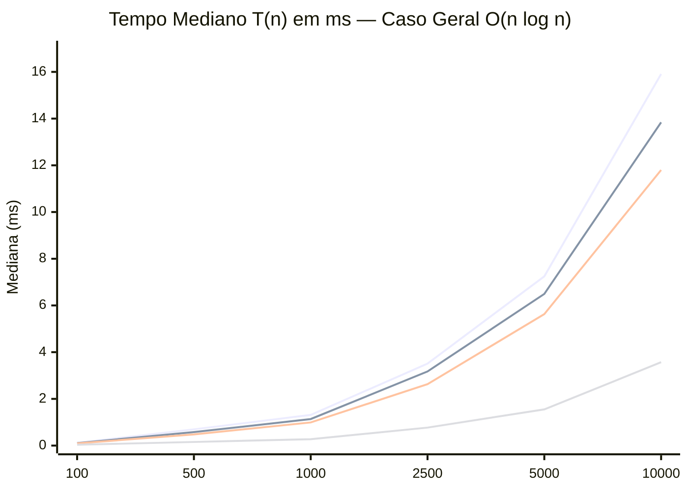
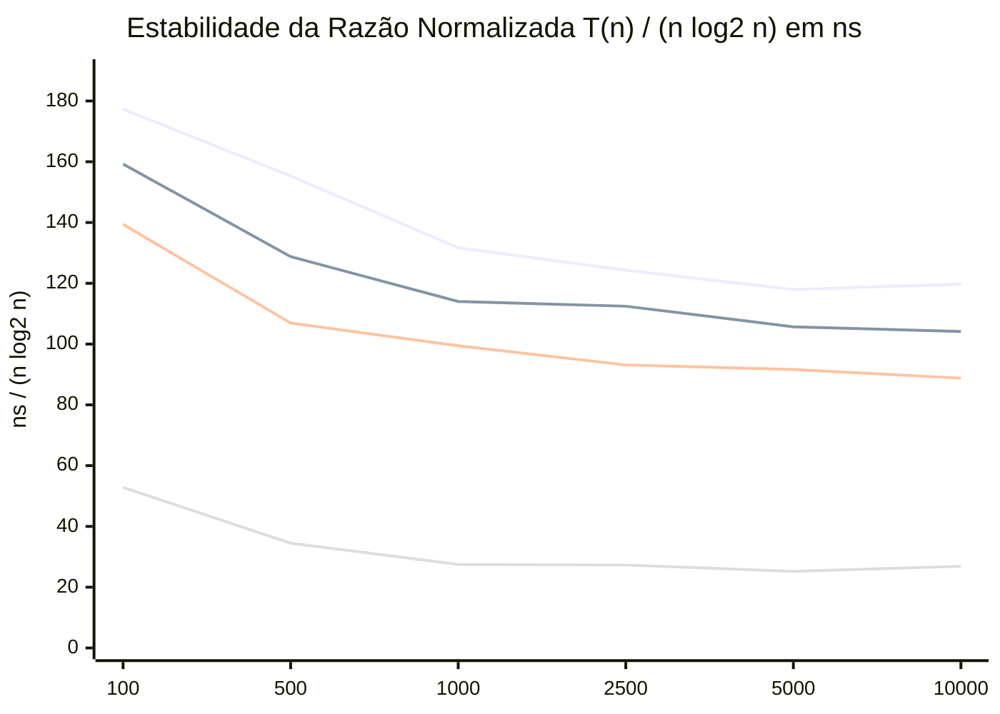
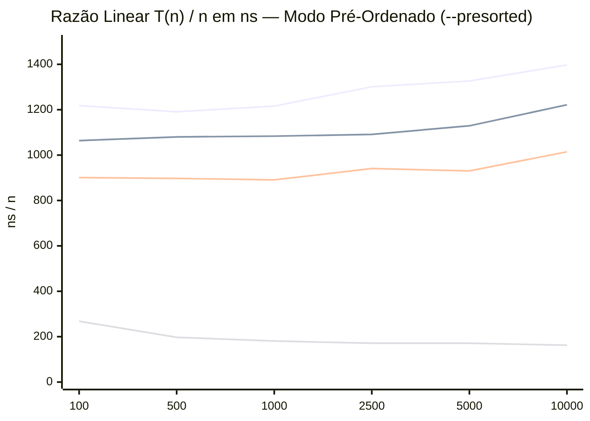

# Relatório de Testes, Benchmark Empírico e Complexidade Assintótica

Este relatório consolida todas as evidências automatizadas e experimentais obtidas diretamente a partir do código-fonte de `escalonamento-intervalos-paa`, comprovando a **corretude formal (100% de otimalidade exata)** e a **equivalência assintótica ($\Theta(n \log n)$ geral e $\Theta(n)$ pré-ordenado)** entre o **Guloso Adaptado** e a **Programação Dinâmica Adaptada**.

---

## Sumário

- [1. Resumo da Suíte de Testes Automatizados](#1-resumo-da-suíte-de-testes-automatizados)
- [2. Verificação Determinística dos Cenários (`SC-01` a `SC-05b`)](#2-verificação-determinística-dos-cenários-sc-01-a-sc-05b)
- [3. Validação Cruzada com Oráculo Exato ($n \le 20$)](#3-validação-cruzada-com-oráculo-exato-n-le-20)
- [4. Benchmark Empírico de Escalabilidade ($\Theta(n \log n)$ e $\Theta(n)$)](#4-benchmark-empírico-de-escalabilidade-thetan-log-n-e-thetan)
- [5. Comandos de Reprodução](#5-comandos-de-reprodução)

---

## 1. Resumo da Suíte de Testes Automatizados

Toda a verificação do projeto é executada via `pytest` em menos de 5 segundos (requisito não funcional `[RNF-01]`), sem dependências externas além do próprio `pytest`:

| Arquivo de Teste | Escopo Coberto | Principais Cenários / Garantias |
| :--- | :--- | :--- |
| [`tests/test_domain_models.py`](../tests/test_domain_models.py#L1-L143) | Imutabilidade e invariantes de domínio | Rejeição de $s_i \ge f_i$, `CLEAN` com $c_i > 0$, `CONTAMINATED` com $c_i \le 0$, janela $[A, B]$ inválida, booleanos como inteiros |
| [`tests/test_preprocessing.py`](../tests/test_preprocessing.py#L1-L153) | Viabilidade ativa e cálculo fechado de $r_i$ | `TP-01`, `SC-02`, `SC-03`, `TE-01` (`SC-04a`), `TE-03` (bordas exatas $e_i = A$ e $e_i = B$), não mutação (`TE-06`) |
| [`tests/test_classic_schedulers.py`](../tests/test_classic_schedulers.py#L1-L212) | Baselines clássicas (Guloso e PD) | Equivalência no `SC-01`, modo `is_presorted=True` e `presorted_start_indices`, isolamento do modo clássico puro |
| [`tests/test_adapted_schedulers.py`](../tests/test_adapted_schedulers.py#L1-L299) | Algoritmos adaptados e redução ingênua | `TP-02`..`TP-05`, prova `SC-02` (`2` vs `1`), `SC-03`, `SC-04a/b/c`, `SC-05`, rejeição de `presorted_start_indices` após descarte |
| [`tests/test_oracle_and_comparison.py`](../tests/test_oracle_and_comparison.py#L1-L191) | Oráculo exato e benchmark runner | **180 instâncias aleatórias** (`TP-06`), trava $n = 21$ (`TE-04`), fumaça e guardas do benchmark (`TP-07`, `TE-06`) |
| [`tests/test_ui_tracer_and_server.py`](../tests/test_ui_tracer_and_server.py#L1-L505) | Tracer multiestágio, servidor HTTP e CLI | Paridade do tracer, micro-passos da PD, conflitos na Arena, rotas GET/POST, proteção *DoS*/XSS/*path traversal*, máscara `HH:MM` |
| [`tests/test_documentation_integrity.py`](../tests/test_documentation_integrity.py#L1-L175) | Integridade da documentação | Existência de seções, resolução de links relativos, limites `#Lxx-Lyy`, cercas Markdown e ausência de caminhos absolutos |

---

## 2. Verificação Determinística dos Cenários (`SC-01` a `SC-05b`)

Todos os cenários canônicos estão centralizados em [`src/ui/scenarios_catalog.py`](../src/ui/scenarios_catalog.py#L23-L279):

| Cenário | Turno ($H$ / $[A, B]$) | Guloso & PD Clássicos | Redução Ingênua ($f'_i=f_i+c_i$) | Guloso & PD Adaptados | Oráculo Exato | O que Comprova |
| :--- | :--- | :---: | :---: | :---: | :---: | :--- |
| **`SC-01`** | `shift_config = None` (8 `CLEAN`) | `5` (`C1,C3,C6,C7,C8`) | `5` | **`5`** | `5` | Retrocompatibilidade exata com o problema clássico |
| **`SC-02`** | $H = \text{18:00}$, sem pausa (3 cirurgias) | Seleciona `S1, S3` (**conflito real** `S1->S3`) | `1` (`S2`; descarta `S3`) | **`2` (`S2, S3`)** | `2` (`S2, S3`) | Prova de não-redutibilidade estática e otimalidade adaptada |
| **`SC-03`** | $H = \text{18:00}$, sem pausa (`S_END`, `S_OVER`) | Seleciona ambos (**viola $H$**) | `0` (descarta `S_END` e `S_OVER`) | **`1` (`S_END`)**, 1 descarte | `1` (`S_END`) | Esterilização passiva após $H$ aceita; atuação médica $> H$ rejeitada |
| **`SC-04a`** | $H = \text{18:00}$, $[12:00, 13:00]$ | Seleciona sobreposições (**inválido**) | `2` (`TOUCH_PRE, TOUCH_POST`) | **`2` (`TOUCH_PRE, TOUCH_POST`)**, 2 descartes | `2` | Sobreposição ativa em $[A, B)$ rejeitada; toques exatos em $A$ e $B$ aceitos |
| **`SC-04b`** | $H = \text{18:00}$, $[12:00, 13:00]$ | `2` (ignora pausa) | `1` (descarta `ABSORBED` por $e_i=12:15 \in (A, B)$) | **`2` (`ABSORBED, NEXT_AT_B`)**, $r_1 = \text{13:00}$ | `2` | Esterilização absorvida pela troca de plantão ajusta $r_i = B$ |
| **`SC-04c`** | $H = \text{18:00}$, $[12:00, 13:00]$ | `2` (ignora $c_i$ transbordando) | `1` (descarta `OVERFLOW` por cruzar $[A, B]$) | **`2` (`OVERFLOW, VALID_AFTER_RELEASE`)**, $r_1 = \text{13:15}$ | `2` | Transbordamento além de $B$ bloqueia `13:00`, mas libera `13:15` |
| **`SC-05a`** | $H = \text{18:00}$, $[12:00, 13:00]$ | Seleciona inviáveis | `0` (3 descartes) | **`0`**, 3 descartes | `0` | Tratamento seguro quando 100% das entradas são inviáveis |
| **`SC-05b`** | $H = \text{18:00}$, $[12:00, 13:00]$ | `2` | `1` (descarta `TIE_ABSORBED`) | **`2`**, desempate determinístico | `2` | Estabilidade e otimalidade sob empate exato em $r_i = \text{13:00}$ |

---

## 3. Validação Cruzada com Oráculo Exato ($n \le 20$)

Em [`test_tp06_randomized_equivalence_against_exact_oracle`](../tests/test_oracle_and_comparison.py#L63-L125):
- Foram geradas **180 instâncias aleatórias determinísticas** (`seed = 20261118`) variando $n \in [0, 16]$, horizontes $H \in \{720, 960, 1080, 1200\}$, presença ou ausência de janela $[A, B]$, proporção de cirurgias contaminadas ($50\%$) e durações $c_i \in [5, 90]$.
- **Resultado observado**: em **180 de 180 instâncias (100%)**:
  - $\text{AdaptedGreedy.total\_selected} == \text{AdaptedDP.total\_selected} == \text{BruteForceOracle.total\_selected}$
  - Contagem idêntica de descartes por inviabilidade ativa.
  - Verificação automática de que todas as cirurgias selecionadas respeitam $f_i \le H$, ausência de sobreposição ativa com $[A, B)$ e compatibilidade $s_k \ge r_{k-1}$.
- A trava de segurança do oráculo (`MAX_ORACLE_INPUT_SIZE = 20` em [`brute_force_oracle.py`](../src/schedulers/brute_force_oracle.py#L19-L40)) foi verificada para $n = 21$, lançando `InvalidSchedulingInputError` antes de iniciar qualquer enumeração exponencial.

---

## 4. Benchmark Empírico de Escalabilidade ($\Theta(n \log n)$ e $\Theta(n)$)

### Metodologia Experimental
- **Isolamento de Tempo (`[RNF-02]`)**: conforme definido em [`src/benchmark/runner.py`](../src/benchmark/runner.py#L177-L241), a geração sintética e eventual pré-ordenação ocorrem fora do cronômetro; cada algoritmo mede exclusivamente `time.perf_counter_ns()` ao redor do núcleo de escalonamento.
- **Parâmetros da Coleta**: `sizes = [100, 500, 1000, 2500, 5000, 10000]`, `repetitions = 5`, `seed = 42`, `contaminated_ratio = 0.35`, `horizon = 1080`, executado com Python 3.14.7 em Windows.

### 4.1. Caso Geral — Entrada Não Ordenada ($\Theta(n \log n)$)

| Algoritmo | $n$ | Viáveis ($n'$) | Selecionadas | Mediana (ms) | $T(n) / (n \log_2 n)$ (ns) | $T(n) / n$ (ns) |
| :--- | ---: | ---: | ---: | ---: | ---: | ---: |
| **Classic Greedy** | 100 | 100 | 18 | 0,0351 | 52,83 | 351,00 |
| **Classic DP** | 100 | 100 | 18 | 0,1058 | 159,24 | 1058,00 |
| **Adapted Greedy** | 100 | 100 | 17 | 0,0926 | 139,38 | 926,00 |
| **Adapted DP** | 100 | 100 | 17 | 0,1178 | 177,31 | 1178,00 |
| **Classic Greedy** | 500 | 500 | 34 | 0,1546 | 34,49 | 309,20 |
| **Classic DP** | 500 | 500 | 34 | 0,5773 | 128,78 | 1154,60 |
| **Adapted Greedy** | 500 | 500 | 31 | 0,4794 | 106,94 | 958,80 |
| **Adapted DP** | 500 | 500 | 31 | 0,6963 | 155,32 | 1392,60 |
| **Classic Greedy** | 1000 | 1000 | 40 | 0,2739 | 27,48 | 273,90 |
| **Classic DP** | 1000 | 1000 | 40 | 1,1362 | 114,01 | 1136,20 |
| **Adapted Greedy** | 1000 | 1000 | 35 | 0,9910 | 99,44 | 991,00 |
| **Adapted DP** | 1000 | 1000 | 35 | 1,3123 | 131,68 | 1312,30 |
| **Classic Greedy** | 2500 | 2500 | 48 | 0,7701 | 27,29 | 308,04 |
| **Classic DP** | 2500 | 2500 | 48 | 3,1734 | 112,46 | 1269,36 |
| **Adapted Greedy** | 2500 | 2500 | 45 | 2,6282 | 93,13 | 1051,28 |
| **Adapted DP** | 2500 | 2500 | 45 | 3,5086 | 124,33 | 1403,44 |
| **Classic Greedy** | 5000 | 5000 | 52 | 1,5492 | 25,22 | 309,84 |
| **Classic DP** | 5000 | 5000 | 52 | 6,4935 | 105,69 | 1298,70 |
| **Adapted Greedy** | 5000 | 5000 | 50 | 5,6306 | 91,65 | 1126,12 |
| **Adapted DP** | 5000 | 5000 | 50 | 7,2459 | 117,94 | 1449,18 |
| **Classic Greedy** | 10000 | 10000 | 59 | 3,5702 | 26,87 | 357,02 |
| **Classic DP** | 10000 | 10000 | 59 | 13,8397 | 104,15 | 1383,97 |
| **Adapted Greedy** | 10000 | 10000 | 56 | 11,7984 | 88,79 | 1179,84 |
| **Adapted DP** | 10000 | 10000 | 56 | 15,9099 | 119,73 | 1590,99 |





### 4.2. Caso Pré-Ordenado ($\Theta(n)$ com `--presorted`)

| Algoritmo | $n$ | Viáveis ($n'$) | Selecionadas | Mediana (ms) | $T(n) / (n \log_2 n)$ (ns) | $T(n) / n$ (ns) |
| :--- | ---: | ---: | ---: | ---: | ---: | ---: |
| **Classic Greedy** | 100 | 100 | 18 | 0,0268 | 40,34 | 268,00 |
| **Classic DP** | 100 | 100 | 18 | 0,1064 | 160,15 | 1064,00 |
| **Adapted Greedy** | 100 | 100 | 17 | 0,0901 | 135,61 | 901,00 |
| **Adapted DP** | 100 | 100 | 17 | 0,1218 | 183,33 | 1218,00 |
| **Classic Greedy** | 500 | 500 | 34 | 0,0986 | 21,99 | 197,20 |
| **Classic DP** | 500 | 500 | 34 | 0,5401 | 120,48 | 1080,20 |
| **Adapted Greedy** | 500 | 500 | 31 | 0,4487 | 100,09 | 897,40 |
| **Adapted DP** | 500 | 500 | 31 | 0,5955 | 132,84 | 1191,00 |
| **Classic Greedy** | 1000 | 1000 | 40 | 0,1809 | 18,15 | 180,90 |
| **Classic DP** | 1000 | 1000 | 40 | 1,0835 | 108,72 | 1083,50 |
| **Adapted Greedy** | 1000 | 1000 | 35 | 0,8907 | 89,38 | 890,70 |
| **Adapted DP** | 1000 | 1000 | 35 | 1,2158 | 122,00 | 1215,80 |
| **Classic Greedy** | 2500 | 2500 | 48 | 0,4275 | 15,15 | 171,00 |
| **Classic DP** | 2500 | 2500 | 48 | 2,7283 | 96,68 | 1091,32 |
| **Adapted Greedy** | 2500 | 2500 | 45 | 2,3519 | 83,34 | 940,76 |
| **Adapted DP** | 2500 | 2500 | 45 | 3,2525 | 115,26 | 1301,00 |
| **Classic Greedy** | 5000 | 5000 | 52 | 0,8551 | 13,92 | 171,02 |
| **Classic DP** | 5000 | 5000 | 52 | 5,6454 | 91,89 | 1129,08 |
| **Adapted Greedy** | 5000 | 5000 | 50 | 4,6518 | 75,71 | 930,36 |
| **Adapted DP** | 5000 | 5000 | 50 | 6,6327 | 107,96 | 1326,54 |
| **Classic Greedy** | 10000 | 10000 | 59 | 1,6245 | 12,23 | 162,45 |
| **Classic DP** | 10000 | 10000 | 59 | 12,2161 | 91,94 | 1221,61 |
| **Adapted Greedy** | 10000 | 10000 | 56 | 10,1440 | 76,34 | 1014,40 |
| **Adapted DP** | 10000 | 10000 | 56 | 13,9705 | 105,14 | 1397,05 |



### 4.3. Interpretação dos Resultados
1. **Paridade de Cardinalidade Ótima**: em todos os tamanhos de $n = 100$ até $n = 10000$, `Adapted Greedy` e `Adapted DP` selecionam **exatamente a mesma quantidade ótima de cirurgias** (`17 -> 31 -> 35 -> 45 -> 50 -> 56`), enquanto as versões clássicas superestimam a capacidade da sala (`18 -> 34 -> 40 -> 48 -> 52 -> 59`) por ignorarem os intervalos de esterilização.
2. **Estabilidade Assintótica em $\Theta(n \log n)$**: no caso geral, ao crescer $n$ em $100\times$ (de `100` para `10000`), a razão $T(n)/(n \log_2 n)$ converge suavemente para uma constante (~`88–93 ns` no Guloso Adaptado e ~`118–124 ns` na PD Adaptada), demonstrando que ambos pertencem exatamente à classe $\Theta(n \log n)$.
3. **Ganho Constante no Modo Pré-Ordenado**: no modo `--presorted`, o Guloso Adaptado elimina a ordenação (`list.sort`) e mantém $T(n)/n \approx 890\text{--}1014\text{ ns}$. Na PD Adaptada, sem `presorted_start_indices` explícito, a resolução de predecessores via `bisect` faz o fator $T(n)/(n \log_2 n)$ cair de `119,73` para `105,14` em $n=10000$, e quando `presorted_start_indices` é fornecido (ou os inícios são monótonos), o algoritmo usa o método de dois ponteiros em $\mathcal{O}(n)$ puro ([`protocol.py`](../src/schedulers/protocol.py#L146-L189)).

---

## 5. Comandos de Reprodução

```bash
# Executar toda a suíte de testes automatizados
python -m pytest -v

# Reproduzir tabela do caso geral O(n log n)
python -m src.main --benchmark --sizes 100 500 1000 2500 5000 10000 --repetitions 5 --seed 42

# Reproduzir tabela do caso pré-ordenado
python -m src.main --benchmark --sizes 100 500 1000 2500 5000 10000 --repetitions 5 --seed 42 --presorted

# Inspecionar divergência no contrexemplo SC-02
python -m src.main --scenario SC-02
```
